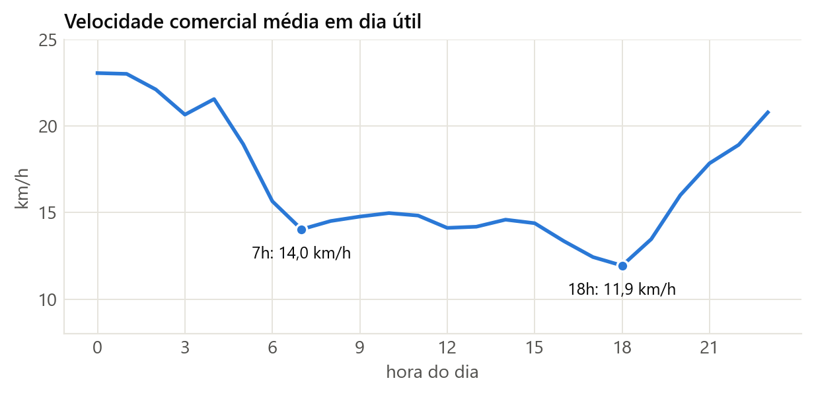
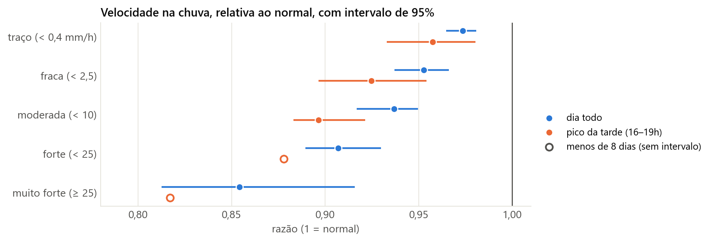
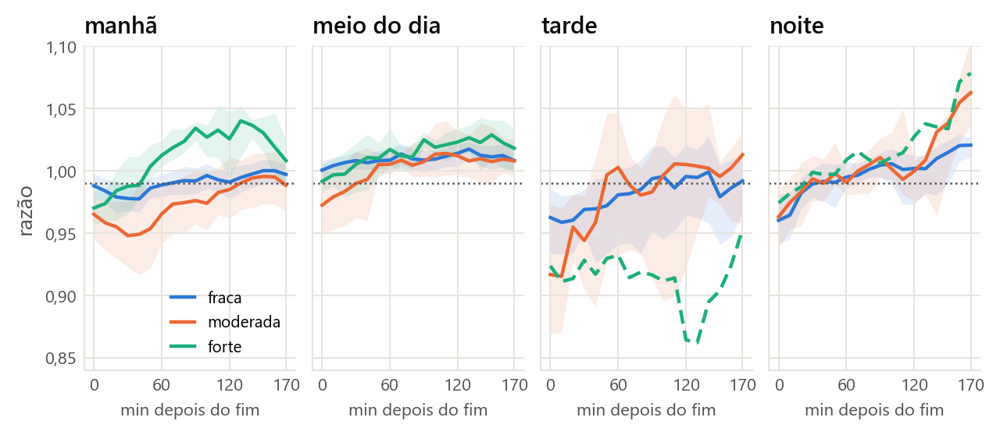
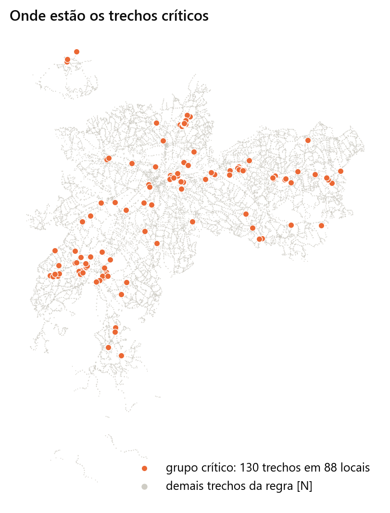
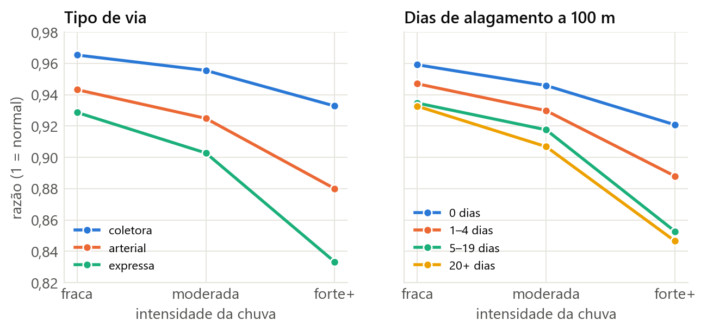
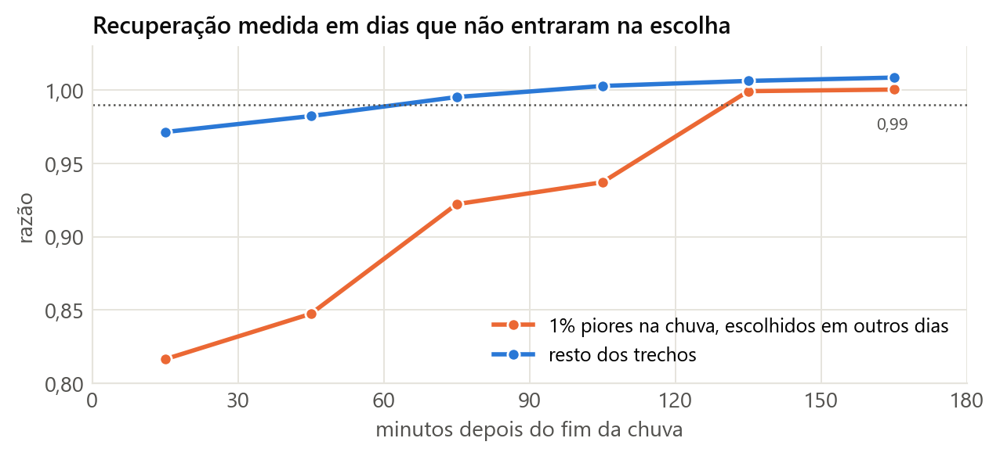

# Como ler este documento {.unnumbered}

Este documento acompanha os dados na ordem em que passam pelo projeto: saem da API da SPTrans, viram tabelas no Databricks e terminam nos resultados dos KRs. Cada capítulo diz o que a etapa recebe, o que faz, o que entrega, o que foi medido e quais decisões foram tomadas. No fim de quase todo capítulo há uma tabela com essas decisões e o motivo de cada uma.

Os capítulos 1 a 3 apresentam o projeto, a coleta e a organização no Databricks. Os capítulos 4 a 11 cobrem a bronze e a silver. Os capítulos 12 a 18 cobrem a gold. O capítulo 19 reúne os KRs, como cada um foi alcançado e em que pé está. Os capítulos 20 e 21 tratam das limitações e do que falta. Os apêndices trazem a ordem para rodar tudo de novo, a lista de tabelas, um glossário e os problemas encontrados pelo caminho.

Algumas convenções valem para o documento inteiro:

- **Períodos.** Os dados de ônibus vão de 25/08 a 01/11/2026, e o job diário continua acrescentando dias. A chuva vai até 25/10, então todas as análises da gold vão de 25/08 a 25/10.
- **Nomes de tabela.** As tabelas estão no catálogo `onibus`. O texto escreve `silver.deslocamento` no lugar de `onibus.silver.deslocamento`.
- **Horários.** Os horários citados são de São Paulo. Quando um dado está em UTC, o texto avisa.
- **Razão.** A partir do capítulo 14, a medida principal é a razão entre a velocidade observada e a velocidade esperada para aquele trecho e horário. Razão 1 é o normal, e 0,90 é 10% mais lento que o normal.

# 1. O projeto

## 1.1 A pergunta

O objetivo, definido com o Rafael, é **identificar onde a chuva mais degrada a malha de ônibus de São Paulo e quais elementos da infraestrutura estão associados a essa perda**. O projeto está vinculado à disciplina MAE0350 do IME-USP, com reunião semanal às segundas.

A pergunta passou por três versões. A primeira media a regularidade do intervalo entre ônibus por linha. A segunda perguntava quanto da variância do tempo de espera era explicada pela chuva. A atual usa a **velocidade dos ônibus por trecho** como medida principal.

A velocidade usada é a comercial: inclui paradas em ponto e em semáforo, que é o que o passageiro sente. A chuva funciona como tratamento, porque ninguém a decide olhando o trânsito. Duas dificuldades permanecem. Chuva forte costuma cair em certos horários, e cada horário tem sua própria velocidade normal. Além disso, janelas do mesmo dia não são independentes, porque a mesma frente fria atinge milhares de trechos ao mesmo tempo. Boa parte do desenho da gold existe para lidar com essas duas questões.

## 1.2 Os KRs

Os resultados-chave seguem o formato de OKR do Rafael, em que cada KR recebe uma nota de 0 a 1.

| KR | Enunciado |
|---|---|
| KR1 | Quantificar a redução da velocidade durante a chuva em pelo menos [N] trechos |
| KR2 | Quantificar o tempo de recuperação da velocidade após a chuva em pelo menos [N] trechos |
| KR3 | Identificar os 10 trechos mais afetados, com ranking estatisticamente estável |
| KR4 | Avaliar a associação entre degradação e dois atributos de infraestrutura: tipo de via e histórico de alagamento |
| KR5 (aspiracional) | Prever a degradação dos trechos na hora seguinte a partir da chuva observada |

O [N] virou uma regra de dado mínimo por trecho, definida no capítulo 17. O capítulo 19 retoma cada KR com o resultado.

## 1.3 As fontes de dados

| Fonte | O que traz | Frequência | Uso |
|---|---|---|---|
| **API Olho Vivo** (SPTrans) | posição de cada ônibus | 1 min (2 min até 20/09) | velocidade |
| **GTFS** (SPTrans) | linhas, traçados e paradas | versões baixadas à mão | transformar posição em metro da rota, definir trechos |
| **SIBH** (DAEE/SP Águas) | chuva por posto | 10 min | tratamento |
| **GeoSampa** (Prefeitura) | tipo de via, faixas, corredores, ocorrências | versão de 02/11 | KR4 |
| **KMZ** (SPTrans) e **lentidão CET** | velocidade oficial em vias e lentidão por região | 1 min e 10 min | coletados para validação, ainda sem uso |

## 1.4 Como os dados fluem

O projeto usa a arquitetura medalhão, com três camadas. A **bronze** guarda o que a fonte disse. A **silver** limpa e enriquece, descrevendo o que aconteceu de fato. A **gold** cruza velocidade e chuva e responde aos KRs.

```
 COLETA   API Olho Vivo ──1 min──▶ VM ──noite──▶ Google Drive
                                                     │ 10h
 BRONZE   arquivos no volume ──▶ bronze.posicao (556 M linhas)
                                        │
 SILVER   gtfs_* ─▶ posicao_limpa ─▶ posicao_rota ─▶ deslocamento ─▶ velocidade_trecho
                                                                           │
 CHUVA    SIBH (à mão) ─▶ bronze.chuva_sibh ─▶ chuva_10min, postos         │
                                                   │                       │
 GOLD     trecho, chuva por posto, eventos  ◀──────┘                       │
                     │                                                     │
          obs_trecho_10min + linha de base  ◀──────────────────────────────┘
                     │
          trecho_infra  ◀── GeoSampa (à mão)
                     │
          efeito e recuperação: cidade, grupos e trechos (KRs)
```

Cada etapa é um notebook numerado, e a ordem dos números é a ordem de execução:

| Notebook | Camada | Entrega |
|---|---|---|
| `00_ingestao_drive` | bronze | copia os arquivos do Drive para o volume |
| `01_bronze_posicao` | bronze | `bronze.posicao` |
| `02_silver_gtfs` | silver | `silver.gtfs_*` |
| `03_silver_posicao_limpa` | silver | `silver.posicao_limpa`, `silver.quarentena_posicao` |
| `04_silver_posicao_rota` | silver | `silver.posicao_rota` |
| `05_silver_deslocamento` | silver | `silver.deslocamento` |
| `06_silver_velocidade_trecho` | silver | `silver.gtfs_trechos`, `silver.velocidade_trecho` |
| `07_silver_chuva` | bronze e silver | `bronze.chuva_sibh`, `silver.chuva_10min`, `silver.postos` |
| `08_gold_base` | gold | trechos, postos de cada trecho, chuva por posto, eventos |
| `09_gold_obs_base` | gold | observações, linha de base, razão |
| `10_gold_efeito_cidade` | gold | KR1 e KR2 na cidade |
| `11_gold_trecho_infra` | gold | infraestrutura por trecho |
| `12_gold_efeito_trecho` | gold | KR1, KR3 e KR4 por trecho |
| `13_gold_recuperacao_trecho` | gold | KR2 por trecho e por grupo |
| `metadados` | todas | descrição de cada tabela e coluna |

## 1.5 Quatro hábitos usados em todas as etapas

**Toda tabela confere com a anterior.** Cada notebook faz uma conta que tem que fechar. Na bronze, as linhas do dia têm que ser iguais ao que a auditoria da coleta registrou. Na silver, `bronze = limpa + quarentena`. Se a conta não fecha, o notebook falha. Foi assim que apareceram quase todos os problemas listados no apêndice D.

**As regras marcam, e os dados ficam.** Uma regra de qualidade vira uma coluna, como `situacao`, `motivo`, `status` ou uma flag. As linhas continuam na tabela, o que permite mudar a regra depois e medir o efeito da mudança.

**Primeiro um pedaço pequeno.** Cada lógica nova rodou antes em um dia e poucas linhas de ônibus, com gráficos para olhar, ou em dados sintéticos no PC. Só depois foi para a base inteira.

**Tudo fica escrito.** Cada tabela e coluna tem descrição no catálogo. Os notebooks explicam suas regras no próprio texto. O repositório guarda o código, os documentos em `docs/` e o `CLAUDE.md`, que resume o estado do projeto.

# 2. Coleta: da API para a VM

## 2.1 A API Olho Vivo

A API da SPTrans mostra a situação atual dos ônibus e não guarda histórico. Quem quer o passado precisa ter gravado no momento em que aconteceu. Por isso existe a coleta: uma máquina consulta a API sem parar e guarda cada resposta.

A autenticação é um `POST /Login/Autenticar?token=...`, que devolve `true` e um cookie de sessão. O POST exige `Content-Length: 0` explícito, senão a API responde 411. A consulta `/Posicao` devolve todas as linhas em circulação, cada uma com seus veículos:

| Campo | Significado |
|---|---|
| `p` | prefixo do veículo: identifica o ônibus físico |
| `ta` | instante da posição na fonte, em UTC |
| `py`, `px` | latitude e longitude |
| `c` | letreiro da linha, igual ao `route_id` do GTFS |
| `cl` | código interno de linha + sentido |
| `sl` | sentido (1 ou 2) |
| `lt0`, `lt1` | os dois terminais da linha |
| `a` | veículo acessível |
| `qv` | número de veículos da linha |

Medições feitas com os dados coletados mostram como a fonte se comporta:

- A SPTrans atualiza as posições a cada ~45 segundos. Consultando a cada minuto, capturamos cerca de 75% das atualizações.
- A idade da posição tem mediana de 22 s.
- As posições já vêm encaixadas no traçado pela SPTrans: 99,8% têm erro lateral de 0,00 m. O dado descreve "posições publicadas pelo operador", e o erro lateral não serve como controle de qualidade.
- A frota tem ~8.900 veículos em média e ~11.200 no pico.
- A API não informa velocidade. Os campos `sv` e `is` existem na resposta, mas vêm sempre nulos.

## 2.2 A VM

A coleta roda numa VM da DigitalOcean (Ubuntu 24.04, 1 vCPU, 512 MB, US$ 4 por mês), em Nova York, no usuário `gabriel`. O script `coletor.py` é executado por um timer do systemd a cada minuto. Cada ciclo faz login, consulta `/Posicao`, grava o resultado e acrescenta uma linha em `auditoria.csv`.

A auditoria é o batimento cardíaco da coleta. Ela registra o instante do ciclo, o status, quantos veículos vieram, o arquivo gravado e o erro, se houve. Mais adiante, a bronze é conferida contra ela, linha a linha.

A cada noite, às 5h UTC, o `backup.sh` usa o `rclone` para mandar os dados ao Google Drive, na pasta `olhovivo-bronze`. Arquivos com mais de 48 horas são movidos, o que libera o disco da VM, e os mais novos são copiados. Assim o Drive sempre tem o dia anterior completo quando o Databricks vai buscar.

## 2.3 A linha do tempo da coleta

| Quando (UTC) | O que mudou |
|---|---|
| 25/08 22:18 | início da coleta, a cada 2 min, em formato achatado (v1) |
| 21/09 02:51 | início do coletor da lentidão CET |
| 21/09 02:55 | cadência passa para **1 min** |
| 21/09 ~03:06 | formato passa a ser a **resposta crua** da API (v2) |
| 27/09 21:36 | início do coletor KMZ |
| 27/09 21:46 | coletor corrigido: novas tentativas quando a API devolve `null`, login auditado, token mascarado no log |

A diferença entre os formatos aparece no capítulo 4. Na v1, o coletor já transformava a resposta em uma linha por ônibus e tirava duplicatas. Na v2, ele guarda a resposta exatamente como veio, e todo tratamento fica para depois.

## 2.4 O que se perde na coleta

Entre 21/09 e 27/09, a auditoria mostrou 9.697 ciclos, com 118 respostas `null` e 38 ciclos sem registro por falha de login, ou cerca de 1,6% de perda. Na auditoria do início da coleta, os 163 erros eram todos a API devolvendo HTTP 200 com corpo `null`. O maior buraco entre ciclos bons foi de 8,5 min até 13/09.

Houve uma falha grande da fonte: no **domingo 11/10, das ~6h às ~13h**, a API respondeu 503 no login. Esse dia tem poucas posições, mas nenhum dia útil teve falha parecida.

## 2.5 Os outros coletores

Dois coletores rodam em paralelo e ainda não entraram na análise. O `coletor_kmz.py` guarda a velocidade oficial por trecho de via que a SPTrans publica. O `coletor_cet.py` guarda a lentidão por região do site da CET, que atualiza a cada 30 min. Os dois servem para validar a velocidade calculada aqui, com uma fonte externa.

## 2.6 Decisões da coleta

| Decisão | Motivo |
|---|---|
| Coletar numa VM própria e barata | a API não tem histórico, e a rede do Databricks não alcança a SPTrans (seção 3.2) |
| Passar de 2 min para 1 min | capturar mais atualizações da fonte, que atualiza a cada ~45 s |
| Guardar a resposta crua a partir de 21/09 | manter a fonte intacta e deixar o tratamento para as camadas seguintes |
| Manter o token da SPTrans | decisão do Gabriel em 27/09: baixo risco, e o log passou a mascarar o valor |
| Guardar tudo no Drive pessoal de 2 TB | já estava disponível, com espaço de sobra para o projeto |

# 3. Organização no Databricks

## 3.1 O que existe

O workspace usa **Unity Catalog** com um catálogo, `onibus`, e três schemas: `bronze`, `silver` e `gold`. Os arquivos crus ficam no volume `bronze.raw`, em pastas:

```
/Volumes/onibus/bronze/raw/
├── olhovivo/        posições (bronze_posicao/ = v1, bronze_raw/ = v2) e auditoria.csv
├── gtfs/            versao=AAAA-MM-DD/
├── chuva/sibh/      download=2026-10-25/ (18 CSVs, stations.json, manifesto.csv)
└── infra/           versao=2026-11-02/ (GeoSampa e manifesto.csv)
```

As tabelas são Delta e particionadas por `dt`, o dia. O processamento roda em **serverless**, sem cluster para administrar. Os notebooks ficam em `/Users/diasg270@gmail.com/onibus/` e no GitHub, em repositório privado.

O plano é Enterprise, ativado por engano em 04/10, com US$ 1.000 em créditos válidos até 23/09/2027. Esse plano tem unidade de processamento mais cara, e manter ou trocar de plano está entre as perguntas para o Rafael.

## 3.2 O limite que definiu a ingestão

O serverless deste workspace tem saída de rede restrita. Nos testes de 03/10, alcançou `pypi.org` e `*.googleapis.com` e não alcançou a API da SPTrans. Mesmo depois do plano Enterprise, a tentativa de liberar o domínio da SPTrans não funcionou.

Daí veio o desenho final: a **VM coleta e guarda no Drive, e o Databricks busca no Drive**. A API do Drive está em `googleapis.com`, então é alcançável. O GeoSampa e o SIBH também estão fora do alcance, por isso são baixados no PC e enviados ao volume.

## 3.3 Como os notebooks se comportam

Vários padrões se repetem e valem a explicação uma vez só.

**Parâmetro `dias`.** Os notebooks 03 a 06 aceitam um widget: vazio processa tudo, uma lista processa aqueles dias, e `ontem` processa o dia anterior em São Paulo. O job usa `ontem`.

**Idempotência.** Com `dias` preenchido, a gravação usa `replaceWhere`, que troca só as partições daqueles dias. Rodar duas vezes dá o mesmo resultado, e dá para reprocessar um dia sem tocar nos outros.

**Modo teste.** Os notebooks 05 e 06 têm o widget `linhas`. Preenchido, roda poucas linhas e só mostra os resultados. Vazio, grava.

**Pandas dentro do Spark.** A lógica mais difícil (projetar posições, ratear pares) é escrita em pandas e numpy e aplicada por grupo com `applyInPandas` e `cogroup`. Um grupo é um traçado em um dia.

**Checagens.** Toda checagem que não fecha levanta erro, e o run fica vermelho.

**Metadados.** O notebook `metadados` é a fonte única das descrições. Gravar com `overwriteSchema` apaga os comentários das colunas, então cada notebook termina com `%run ./metadados` e `aplicar_metadados(tabela)`.

## 3.4 Decisões da organização

| Decisão | Motivo |
|---|---|
| Databricks puxa do Drive com uma conta de serviço | a rede alcança `googleapis.com`, e dá para carregar o histórico sem depender do PC |
| Chave da conta de serviço em secret (`onibus/gdrive_sa`) | a chave nunca aparece em código, e o robô só tem leitura na pasta |
| Partição por dia em todas as tabelas de posição | reprocessar um dia sem refazer o resto |
| Um notebook por etapa, numerado | a ordem de execução fica evidente |
| Descrições em um notebook único | evita descrição divergente entre notebooks |

# 4. Bronze: o que a API disse

## 4.1 A regra da camada

A bronze responde a uma pergunta: o que a fonte disse? Ela guarda os dados sem limpeza, sem correção e sem cruzar com nada. Se uma regra da silver estiver errada, tudo pode ser refeito a partir dela.

## 4.2 Notebook 00: do Drive para o volume

O `00_ingestao_drive` copia os arquivos de um dia. Ele se autentica como o robô, transforma a chave num token temporário de cerca de 1 hora, com escopo só de leitura, e desce pelas pastas do Drive até a do dia. Baixa em paralelo, com threads, porque cada arquivo é pequeno e quase todo o tempo é espera de rede. Arquivo que já existe no volume com o mesmo tamanho é pulado, então rodar duas vezes não duplica nada.

O passo final confere se **todo arquivo que a auditoria diz que existe está no volume**. Essa conferência existe por causa de um problema real: a listagem do Drive às vezes vinha incompleta, com 1.392 de 1.439 arquivos. O notebook repete a listagem e tenta de novo com espera crescente quando a API falha.

Para o histórico, o job `backfill_drive` usou uma tarefa For each sobre a lista de dias em `jobs/backfill_inputs.json`, levou 25 minutos e rodou uma vez.

## 4.3 Notebook 01: dos arquivos para a tabela

O `01_bronze_posicao` junta os dois formatos numa tabela com **uma linha por ônibus por ciclo**.

| | v1 (25/08 a 21/09) | v2 (21/09 em diante) |
|---|---|---|
| Pasta | `bronze_posicao/` | `bronze_raw/` |
| Arquivo | `.ndjson.gz`, já achatado | `.json.gz`, resposta inteira da API |
| Ciclo | ~2 min | 1 min |
| Duplicatas | tiradas pelo coletor | mantidas |

O schema é declarado no código. O Spark não precisa ler tudo para adivinhar os tipos, e uma mudança da SPTrans aparece como erro. Na v2, a resposta é aninhada, e dois `explode` a abrem: resposta, linhas, veículos. O instante da coleta vem do nome do arquivo. Na v1, `p` vem como texto e vira número. As duas partes se juntam com `unionByName`, e a coluna `formato` diz de onde veio cada linha. A única coisa descartada são os arquivos `null`, que não têm conteúdo.

A checagem compara, por dia, as linhas da tabela com a soma de `veiculos_gravados` dos ciclos bons da auditoria. A diferença tem que ser zero, e foi zero em todos os dias.

## 4.4 A tabela

| Coluna | O que é |
|---|---|
| `dt` | dia de São Paulo do ciclo (partição) |
| `coletado_em` | quando a VM recebeu, em UTC |
| `ta` | quando a SPTrans registrou a posição, em UTC |
| `p` | o ônibus físico |
| `c`, `cl`, `sl` | linha, código interno, sentido |
| `py`, `px` | latitude, longitude |
| `arquivo`, `formato` | arquivo de origem e versão do formato |

Hoje são **556,2 milhões de linhas** em 69 dias: 122,5 M na v1 e 433,7 M na v2.

Três campos sustentam o projeto: `p`, `ta` e a posição. O mesmo `p` ao longo de vários `ta` forma uma trajetória.

## 4.5 Um exemplo real

O ônibus 48874, da linha 507T (Metrô Carrão ↔ Terminal Sapopemba), chegando ao terminal em 29/09, com horário de SP:

| `ta` | `sl` | `py` | `px` |
|---|---|---|---|
| 08:00:22 | 2 | −23,60605 | −46,50314 |
| 08:01:52 | 2 | −23,60955 | −46,50136 |
| 08:02:37 | 2 | −23,61200 | −46,50138 |
| 08:03:58 | 2 | −23,61391 | −46,50091 |
| 08:04:50 | **1** | −23,61412 | −46,50123 |
| 08:05:35 | 1 | −23,61412 | −46,50123 |
| 08:06:20 | 1 | −23,61412 | −46,50123 |

Nessa pequena tabela já estão várias regras da silver. O ônibus anda para o sul nas quatro primeiras linhas. Às 08:04 chega ao terminal e troca de sentido. Depois fica parado com `ta` avançando: a linha muda, mas o ônibus não sai do lugar. Se isso entrasse na velocidade, viraria 0 km/h sem nada a ver com chuva. O intervalo entre posições também varia (90, 45, 81, 52 segundos), porque a fonte atualiza em um ritmo e nós consultamos em outro.

## 4.6 Decisões da bronze

| Decisão | Motivo |
|---|---|
| Nenhuma limpeza na bronze | permite refazer tudo se uma regra posterior estiver errada |
| Dois formatos numa tabela só, com coluna `formato` | a silver lê uma fonte única, e as diferenças ficam rastreáveis |
| Schema explícito | leitura mais rápida, e mudança na fonte vira erro visível |
| Conferir contra a auditoria | a auditoria é uma contagem independente da tabela |
| Usar `ta` como relógio da velocidade | é o instante da posição na fonte; `coletado_em` só diz quando a VM recebeu |

# 5. Silver: o GTFS

## 5.1 O que é e para que serve

A silver responde a outra pergunta: o que aconteceu de fato? Para saber onde um ônibus estava na rota, é preciso conhecer a rota. Essa informação vem do GTFS, o formato padrão de dados de transporte público, que a SPTrans publica para download sem login.

O `02_silver_gtfs` lê os arquivos e grava uma tabela por arquivo:

| Tabela | Uma linha é | Uso |
|---|---|---|
| `gtfs_routes` | uma linha de ônibus | `route_id` é o `c` da API |
| `gtfs_trips` | uma viagem-modelo | linha + sentido levam ao traçado (`shape_id`) |
| `gtfs_shapes` | um ponto do traçado | a régua da rota, com distância acumulada em metros |
| `gtfs_stops` | uma parada | posição das paradas |
| `gtfs_stop_times` | uma parada de uma viagem | ordem das paradas, de onde saem os trechos |
| `gtfs_frequencies` | uma faixa horária | intervalo programado, para uso secundário |
| `gtfs_calendar` | um tipo de serviço | dias de operação |
| `gtfs_versao` | uma versão | qual versão usar em cada dia |

A coluna mais importante é `shape_dist_traveled`, em `gtfs_shapes`. Ela diz a quantos metros do início da rota está cada ponto do traçado, e é a régua usada no capítulo 7.

São 1.361 linhas e 2.271 viagens-modelo, uma por traçado. O GTFS da SPTrans é baseado em frequência: traz intervalos por faixa horária, sem horário exato de cada viagem.

## 5.2 A ponte com a API

Dois encaixes ligam a API ao GTFS. O campo `c` é igual a `route_id` em 99,8% das linhas. O sentido foi validado projetando posições nos dois traçados possíveis: `sl = 1` corresponde a `direction_id = 0`, e `sl = 2` a `direction_id = 1`. Nos 647 grupos decisivos, não houve contraexemplo.

## 5.3 Versões

O GTFS muda com o tempo. Entre as versões de 26/08 e 12/10, 882 dos 2.188 traçados em comum mudaram (a maioria em menos de 15 m, mas 21 em mais de 500 m), 83 viagens trocaram de traçado e 612 das 2.271 mudaram a sequência de paradas.

Por isso cada versão fica guardada, identificada pela data do download, e `gtfs_versao` diz qual vale para cada dia:

| Versão | Vale de | Até |
|---|---|---|
| 2026-08-26 | 25/08 | 11/10 |
| 2026-10-12 | 12/10 | hoje |

A limitação é que sabemos quando baixamos, e não quando a SPTrans mudou. Na semana anterior a um download, parte dos traçados pode estar desatualizada. O erro lateral cresce com o tempo (seção 7.4), o que indica que vale baixar uma versão nova.

## 5.4 Leitura e checagens

A leitura usa schema explícito, confere o cabeçalho (`enforceSchema=False`) e falha diante de um valor fora do tipo (`FAILFAST`). Identificadores e horários ficam como texto, porque horários do GTFS podem passar de 24:00:00 em viagens que viram a noite.

O notebook falha se o número de linhas do arquivo não bater com o da tabela, se uma chave tiver nulo ou repetição, ou se uma referência apontar para algo que não existe, como uma viagem com `shape_id` inexistente.

## 5.5 Decisões do GTFS

| Decisão | Motivo |
|---|---|
| Guardar todas as versões, com coluna `versao` | o traçado certo depende do dia |
| Cada versão vale do seu download até a véspera da seguinte | é a informação disponível sobre quando a mudança ocorreu |
| `sl = direction_id + 1` | validado com dados nos dois traçados |
| Tipos e cabeçalho conferidos na leitura | uma mudança de formato vira erro, e não dado trocado de coluna |

# 6. Silver: posições limpas

## 6.1 O que o notebook 03 faz

O `03_silver_posicao_limpa` recebe a bronze e separa cada posição em dois destinos: `silver.posicao_limpa`, com as que passam, e `silver.quarentena_posicao`, com as que não passam e o motivo. Nada some. A checagem, por dia, é `bronze = limpa + quarentena`.

Cada posição recebe o primeiro motivo que se aplica, nesta ordem:

| Motivo | Regra | Posições | % da bronze |
|---|---|---|---|
| `duplicata` | mesmo `(p, ta)` mais de uma vez; fica a primeira coleta | 4.858.647 | 0,87% |
| `coordenada_invalida` | latitude ou longitude nula ou fora da caixa de SP | 0 | 0% |
| `ta_no_futuro` | `ta` mais de 60 s depois de `coletado_em` | 202.135 | 0,04% |
| `posicao_velha` | `coletado_em − ta` maior que 5 min | 256.070 | 0,05% |
| `linha_sem_shape` | a linha não tem viagem no GTFS do dia | 2.201.012 | 0,40% |
| `sentido_sem_shape` | a linha tem dois sentidos, mas não o da API | 0 | 0% |

Sobram **548,7 milhões de posições** (98,65%), e 7,5 milhões vão para a quarentena.

Algumas regras têm uma história própria. A duplicata pode ter até 220 repetições: é um ônibus "congelado" na API. O limite de 60 s em `ta_no_futuro` existe porque, na v2, `coletado_em` é o início do ciclo, e a requisição pode levar até ~46 s, então um `ta` depois de `coletado_em` é normal dentro desse limite. As linhas sem traçado são 55: serviços especiais como `PAEC-10` e `TREI-10` e cerca de 37 variantes que aparecem em `routes.txt` sem viagens.

## 6.2 O que ganha cada posição

**Horário de SP.** `ta_sp` é o horário de parede de São Paulo. `ta` continua em UTC.

**Tipo de dia.** `tipo_dia` vale `util`, `sabado`, `domingo` ou `feriado`, pela data de `ta_sp`. Os feriados do período estão no notebook: 07/09, 12/10, 02/11, 15/11, 20/11 e 25/12. Em feriado, os ônibus operam com tabela de domingo.

**Traçado.** A posição recebe o `shape_id` certo, a partir da linha, do sentido e da versão do GTFS do dia.

## 6.3 As linhas de sentido único

Cerca de 370 linhas têm um traçado só no GTFS: são as circulares. A API manda `sl = 1` e `sl = 2` nelas também, mas os dois caem em cima do mesmo traçado (erro lateral de 0 m na mediana, no teste com 8 linhas). Essas linhas usam o traçado único e ganham `sentido_unico = true`. No capítulo 8, uma troca de `sl` nelas deixa de significar troca de viagem.

## 6.4 Conferência do fuso

A frota por hora em 08/10 mostrou picos entre 7h e 9h e entre 17h e 19h no horário de São Paulo, como esperado. A checagem veio de um alerta da literatura: um estudo de Niterói mostrava picos três horas antes do normal, sinal de fuso aplicado duas vezes.

## 6.5 Decisões das posições limpas

| Decisão | Motivo |
|---|---|
| Quarentena com motivo | toda posição descartada fica contada e pode ser reavaliada |
| Dedupe por `(p, ta)`, ficando a primeira coleta | a primeira é a mais recente em relação a `ta` |
| Caixa de SP, com margem | guarda contra coordenada absurda; hoje não pega nada |
| `tipo_dia` pela data de `ta_sp` | perto da meia-noite, `dt` e a data de `ta_sp` podem diferir |
| Feriado tratado como dia de tabela de domingo | é como os ônibus operam |

# 7. Silver: posições na rota

## 7.1 A ideia da régua

Uma posição em latitude e longitude é difícil de usar para medir velocidade numa rota com curvas. O `04_silver_posicao_rota` transforma o mapa em uma régua: cada posição vira "o ônibus está no metro *d* da rota".

```
traçado 507T, sentido 1
metro:  0 ─────── 3.200 ──────── 7.340 ──────── 9.820 ─────────── 12.500
        │          │               ●               │                  │
     parada 1   parada 9        ônibus         parada 24          terminal
```

A tabela mantém o mesmo número de linhas da `posicao_limpa`, e cada posição ganha colunas:

| Coluna | O que é |
|---|---|
| `d_m` | metro ao longo do traçado |
| `erro_lateral_m` | distância da posição até o traçado |
| `n_candidatos` | quantas passagens do traçado estavam ali |
| `comprimento_m` | comprimento total do traçado |

## 7.2 A projeção

A posição é projetada ortogonalmente no traçado, num plano equirretangular centrado em São Paulo, com erro abaixo de 0,1% em 50 km. O metro sai da interpolação de `shape_dist_traveled` no segmento mais próximo. O código usa `cogroup` por versão, traçado e dia, e um grupo tem menos de ~60 mil posições.

## 7.3 Traçados que passam duas vezes pela mesma rua

Se um traçado passa duas vezes pelo mesmo lugar, "o ponto mais próximo" é ambíguo. No GTFS de 12/10, isso afeta 0,7% do traçado nas linhas de dois sentidos, em laços de terminal, e **41% nas de sentido único**, que vão e voltam pela mesma avenida. Ali, escolher só pela distância erra a passagem metade das vezes.

A solução usa continuidade. Cada posição guarda as passagens candidatas: até seis, com erro de até o melhor + 10 m, separadas por mais de 150 m ao longo da rota. Para cada ônibus, em ordem de tempo, escolhe-se a sequência de candidatos mais coerente com o algoritmo de Viterbi, em que cada transição tem um custo:

| Transição | Custo |
|---|---|
| andar para a frente a até 80 km/h | ~0 |
| recomeçar a volta, do fim para o início | 50 |
| recuar ou teleportar | 1.000 + distância |
| mais de 5 min sem posição | quebra a continuidade |

O teste, em 08/10, com 4 circulares e 2 linhas normais, somou 93 mil posições:

| Pares consecutivos incoerentes | Só o mais próximo | Com continuidade |
|---|---|---|
| Sentido único | 20,4% | **4,2%** |
| Dois sentidos | 2,9% | 2,9% |

## 7.4 O que sobra e o que foi medido

O que continua incoerente vem do próprio dado e é tratado no capítulo 8. São três fenômenos: a manobra no terminal, em que `d` oscila perto das pontas; o **sentido atrasado**, em que o ônibus já voltou e a API ainda manda o sentido antigo; e o **eco**, em que a API reenvia uma posição antiga com `ta` novo.

O erro lateral cresce com o tempo usando o GTFS de 26/08: o percentil 99 sobe de 0 m no fim de agosto para ~1,4 m em outubro, e a fração acima de 10 m passa de 0,01% para ~0,3%. A SPTrans vai mudando os traçados aos poucos.

As checagens são `rota = limpa` por dia e todo `d_m` entre 0 e o comprimento do traçado.

## 7.5 Decisões da projeção

| Decisão | Motivo |
|---|---|
| Transformar posição em metro da rota | velocidade e trechos ficam contas de uma dimensão |
| Plano equirretangular | erro desprezível na escala da cidade e conta rápida |
| Python com `cogroup` por traçado × dia | lógica testável no PC e grupos pequenos |
| Candidatos + Viterbi | resolve a ambiguidade usando a sequência do ônibus |

# 8. Silver: deslocamentos

## 8.1 O par como unidade

Uma posição sozinha não tem velocidade. Velocidade precisa de dois instantes. A `silver.deslocamento` tem uma linha por **par de posições consecutivas do mesmo ônibus no mesmo dia**: de onde foi, para onde foi, em quanto tempo.

A 1 minuto entre posições, um par anda de 200 a 700 m, mais que um trecho entre paradas, que tem ~300 m. Isso define o capítulo 9.

Os pares são formados dentro do dia, por `(p, dt)`. O par que cruza a meia-noite se perde, num horário com poucos ônibus, e cada dia fica independente: dá para reprocessar um dia sozinho.

## 8.2 Ecos

Antes de formar os pares, saem os ecos: posições com coordenadas idênticas às de 2 ou 3 posições antes, mas diferentes da anterior. A API reenviou uma posição antiga com `ta` novo. Isso acontece em ~1% das posições e não é uma observação. Os ecos entram na conta da checagem, mas não viram par.

## 8.3 As situações

Todo par fica na tabela com uma `situacao`, e só os `ok` seguem para a velocidade. Cada par recebe a primeira que se aplica:

| `situacao` | Regra | Motivo | % dos pares |
|---|---|---|---|
| `buraco` | mais de 5 min entre as posições | coleta perdida | 0,44% |
| `nova_viagem` | mudou de traçado, ou foi do fim (últimos 300 m) para o início (primeiros 300 m) | uma viagem acabou e outra começou | 2,21% |
| `terminal` | as duas pontas a até 200 m do início ou do fim, e andou menos de 50 m | ônibus esperando ou manobrando | 23,58% |
| `recuo` | andou mais de 30 m para trás | inclui o sentido atrasado | 1,71% |
| `rapido` | mais de 80 km/h | impossível para ônibus urbano | 0,32% |
| `parado_longo` | dentro de uma sequência parada que soma ≥ 20 min | frota estacionada fora do terminal | 3,78% |
| `ok` | o resto | vai para a velocidade | **67,96%** |

São **540,4 milhões de pares**, e 367,2 milhões são `ok`. A checagem é `posições = pares + ecos + ônibus`, porque cada ônibus-dia tem uma posição a mais que pares.

**Ônibus lento ou parado no meio da rota fica `ok`.** Velocidade perto de zero num engarrafamento é o sinal que queremos comparar com e sem chuva. Recuos pequenos, entre −30 e 0 m, são ruído e também ficam `ok`, com distância contada como 0.

## 8.4 `parado_longo`: a história da madrugada

No dashboard, a velocidade média caía de madrugada (12,5 km/h às 2h), justo no horário em que deveria ser a mais alta. O meio do dia também parecia lento demais.

A investigação, em 13 a 17/10, mostrou que às 2h **53% do tempo** dos pares `ok` era de ônibus parado, enquanto quem andava fazia 27 km/h. De madrugada, 62% do tempo parado estava em paradas de 20 min ou mais, dois terços delas no meio da rota, a ~3 km das pontas. São garagens e pontos de regulagem. O resto ficava a ~400 m das pontas, em áreas de espera além dos 200 m da regra `terminal`.

Excluindo paradas de 20 min ou mais, em 13 a 17/10:

| Hora | Antes | Depois |
|---|---|---|
| 2h | 12,5 km/h | 22,3 km/h |
| 11h | 13,7 km/h | 14,9 km/h |
| 18h (pico) | 12,1 km/h | 12,4 km/h |

A espera entre viagens também inflava o tempo do meio do dia, e os picos quase não mudaram.

A regra: um par que seria `ok`, dentro de uma sequência de pares do mesmo ônibus com menos de 10 m de movimento que soma 20 min ou mais, vira `parado_longo`. O limite de 20 min foi escolhido porque um ônibus preso em alagamento pode ficar parado de 10 a 20 min, e esse é o sinal do projeto. Um ônibus em trânsito normal quase nunca fica 20 min sem andar nada. Como a situação fica na tabela, dá para medir a sensibilidade a essa regra, mas esse teste ainda não foi feito (capítulo 20).

## 8.5 Como a regra foi validada

O notebook tem um modo de teste, com um dia e poucas linhas, que mostra o **diagrama de Marey**: hora no eixo x, metro da rota no eixo y, uma linha por ônibus. Viagens aparecem como diagonais, mais inclinadas quando mais rápidas. Ônibus parado aparece como trecho horizontal. Dois ônibus colados são um comboio. Os pares fora de `ok` aparecem coloridos, o que mostra se cada regra pegou a coisa certa.

Foi assim que o `recuo` foi entendido: apareceu como trajetórias inteiras descendo por ~30 min, que são viagens reais com o sentido atrasado na API. Hoje esses pares ficam fora. Reprojetá-los no traçado do outro sentido é uma melhoria possível.

A velocidade dos pares `ok` dá 14,7 km/h na v1 e 14,6 km/h na v2. Os dois formatos são comparáveis, e dá para usar o período inteiro.

## 8.6 Decisões dos deslocamentos

| Decisão | Motivo |
|---|---|
| O par de posições é a unidade de observação | velocidade precisa de dois instantes |
| Classificar cada par com uma `situacao` | dá para mudar regra e medir o efeito |
| Parado no meio da rota continua `ok` | é o sinal que o projeto quer medir |
| Limite de 200 m e 50 m para `terminal` | no teste, 91% desses pares tinham menos de 10 m de movimento |
| 20 min em `parado_longo` | separa frota estacionada de ônibus preso no trânsito ou em alagamento |
| Pares dentro do dia | cada dia pode ser reprocessado sozinho |

# 9. Silver: velocidade por trecho

## 9.1 O que é um trecho

Um **trecho** vai de uma parada à seguinte. O `06_silver_velocidade_trecho` tem duas partes: primeiro define os trechos, depois calcula a velocidade em cada um.

## 9.2 Parte A: `gtfs_trechos`

Para ratear pares entre trechos, cada parada precisa estar na mesma régua das posições. As paradas de cada viagem são projetadas no traçado **em ordem**: cada uma tem que cair adiante da anterior.

Essa etapa precisou de três versões, por causa das linhas que vão e voltam pela mesma avenida. A parada do início da ida também fica a poucos metros da volta, na calçada oposta, lá perto do fim da rota.

| Versão | Regra | Trechos | Trechos de 0 m | Erro mediano da parada |
|---|---|---|---|---|
| 1ª | menor erro entre as passagens adiante | 170.291 | 23.479 | 4,8 m |
| 2ª | a passagem boa mais próxima adiante | 192.949 | 821 | 10,0 m |
| 3ª | menor erro entre as passagens que começam até 1,5 km adiante | 193.020 | 750 | 4,7 m |

Na 1ª versão, a parada pulava para a volta e as seguintes ficavam presas lá: uma linha de 146 paradas ficou com 10 trechos. A 3ª usa o fato de que paradas ficam a ~310 m umas das outras. Cada versão foi testada no PC com traçados sintéticos, e uma checagem falha se os trechos de 0 m passarem de 0,5%. Trechos de ~0 m saem da tabela, que hoje tem 193.304 trechos nas duas versões do GTFS.

## 9.3 Parte B: o rateio

Como um par anda mais que um trecho, quase nenhum trecho tem uma posição dentro dele. Cada par `ok` então reparte distância e tempo entre os trechos que atravessou, supondo velocidade constante dentro do par:

```
par: metro 12.060 → 12.330 (270 m) em 45 s; parada no metro 12.150

   12.060 ───────┼──────────────── 12.330
       90 m em 15 s    180 m em 30 s
     trecho anterior   trecho seguinte
```

Cada pedaço vai para a **janela de 10 min** do seu instante médio. Em cada trecho × janela:

```
velocidade = soma das distâncias / soma dos tempos
```

Um par parado conta tempo no trecho onde está, com distância 0. Assim, um par curto e lento pesa menos que um longo, e um ônibus preso acumula tempo no trecho.

A tabela guarda também `n_pares` e `n_onibus`, que dizem quanto dado sustenta cada velocidade. O que o ônibus anda antes da primeira parada e depois da última fica de fora.

## 9.4 Checagens e números

Nenhuma velocidade passa de 80 km/h, o tempo rateado nunca passa do tempo dos pares e ~99,6% do tempo e 99,8% da distância ficaram dentro dos trechos. O rateio foi testado com cinco pares sintéticos (cruzando parada, parado, recuo pequeno, saindo da última parada, fora do traçado), e esse teste pegou um erro de código antes de rodar na base.

A tabela tem **317,1 milhões de linhas**, 29.965 trechos físicos e 1.309 linhas de ônibus. A velocidade comercial média é **15,5 km/h**: 15,08 em dia útil, 16,55 no sábado, 17,75 no domingo e 18,75 em feriado.



## 9.5 Trecho físico

Um trecho de uma linha é `(traçado, sequência)`. O **trecho físico** é `(parada_de, parada_ate)`, sem olhar a linha. Paradas são cadastradas por lado da rua, então o trecho físico tem sentido. Ele junta todas as linhas que passam ali e multiplica as observações nos lugares com mais ônibus. A gold inteira usa o trecho físico.

Essa definição tem um efeito colateral, que apareceu só no KR3: linhas que pulam paradas geram pares diferentes na mesma rua, e trechos físicos podem se sobrepor (seção 17.6).

## 9.6 Decisões da velocidade

| Decisão | Motivo |
|---|---|
| Trecho = par de paradas consecutivas | unidade natural da rede, com precedente no Monitor de Ônibus do IEMA |
| Rateio por sobreposição | os pares são maiores que os trechos |
| Janela de 10 min | casa com a resolução dos pluviômetros |
| Soma das distâncias ÷ soma dos tempos | pondera pelo tempo, e ônibus parado pesa |
| Guardar `n_pares` e `n_onibus` | a gold decide o mínimo de dado |
| Agregar a gold por trecho físico | mais observações por lugar e unidade natural para a infraestrutura |

# 10. Silver: chuva

## 10.1 A fonte

A chuva vem do **SIBH** (`sibh.daee.sp.gov.br`), na telemetria, com a granularidade "Coleta", de 10 min. O site exporta CSV de até 10 postos por consulta e bloqueia automação no `robots.txt`, então a extração foi manual: 161 postos do município em blocos, totalizando 18 arquivos, de 01/08 a 25/10, com dado de **141 postos**. As coordenadas vêm de `stations.json`, capturado pelo DevTools do navegador, com ~3.700 postos do estado. Tudo está em `docs/chuva_sibh.md`.

O formato é `Prefixo, Nome, TipoPosto, Data, Valor, Valor2`. `Valor` é o incremento em mm desde a leitura anterior.

**O horário é UTC.** O Windows registra o horário de salvamento em horário de Brasília. Um arquivo salvo às 18:04 termina em `21:00`, e outro, salvo às 18:55, termina em `21:40`. Se fosse horário de Brasília, os arquivos teriam chuva de 3 horas no futuro. Em UTC, 21:00 são 18:00, a última leitura antes do download. Toda consulta iniciada em 01/08 00:00 também começa às 03:00.

Antes de subir, cada afirmação sobre os dados foi conferida lendo os CSVs. Isso achou 15 valores negativos (manutenção do pluviômetro), uma leitura de 35 mm em 10 min e a identificação correta da rede `3550308xx`, que é do CEMADEN.

## 10.2 As três redes

| Rede | Operador | Postos | Como reporta |
|---|---|---|---|
| `daee` | SAISP, SP Águas, Sabesp, ANA | 83 | grade fixa de 10 min, com zeros explícitos |
| `cemaden` | CEMADEN | 56 | por evento: seco, 1 leitura por hora; chovendo, a cada ~10 min |
| `inmet` | INMET | 2 | horária |

Essa diferença importa na gold. Na rede CEMADEN, a primeira leitura depois de uma hora seca cobre a hora inteira. Repartir essa chuva pelos slots espalha a chuva até 50 min antes de ela começar.

## 10.3 O notebook 07

O `07_silver_chuva` grava três tabelas. `bronze.chuva_sibh` tem as leituras como vieram (1.124.746 linhas), e a checagem é que a soma bata com o manifesto. `silver.chuva_10min` coloca tudo numa grade comum de 10 min em UTC (1.718.603 linhas). `silver.postos` tem uma linha por posto, com coordenadas, rede, qualidade e status.

Cada leitura vale para o intervalo desde a leitura anterior do mesmo posto, repartido igualmente entre os slots:

| Caso | O que acontece |
|---|---|
| leitura a 10 min da anterior | 1 slot, valor inteiro |
| posto a 5 min | duas leituras no mesmo slot, somadas |
| leitura 60 min depois, com 0 mm | 6 slots com 0 |
| leitura 60 min depois, com 3 mm | 6 slots com 0,5 mm e `f_intervalo_longo` |
| intervalo maior que 60 min | só o último slot recebe; os anteriores ficam faltantes |
| leitura negativa | slot nulo, com `f_negativo` |
| slot sem leitura | nulo, com `f_faltante` |

Slot sem leitura é **nulo, nunca zero**: "não sei" e "não choveu" são coisas diferentes. Um slot acima de 30 mm fica com o valor e a marca `f_pico_implausivel`.

A checagem de **conservação** diz que, por posto, a chuva na grade é igual à soma das leituras não negativas: o rateio espalha e não cria chuva. A exceção são dois postos em que uma leitura negativa caiu no mesmo slot de uma positiva.

## 10.4 Qualidade dos postos

Três medidas foram feitas no período com ônibus, desde 25/08. A `completude` é a fração de slots com valor. A `razao_vizinhos` é o total do posto dividido pela mediana do total dos 5 vizinhos confiáveis mais próximos. A `chuva_1209_mm` é o total em 12/09, dia de chuva forte em toda a cidade: posto que marca 0 está quebrado.

O status é o primeiro que se aplica: `sem_dado`, `quebrado` (razão abaixo de 0,4, ou 0 mm em 12/09), `suspeito` (razão acima de 2,0), `lacunar` (completude abaixo de 90%) ou `ok`.

| Rede | ok | lacunar | quebrado |
|---|---|---|---|
| DAEE | 71 | 5 | 6 |
| CEMADEN | 23 | 5 | 27 |
| INMET | 1 | 1 | 0 |

A tabela soma 139 postos. Os outros 2 não têm leitura desde 25/08 e vão aparecer como `sem_dado` quando o notebook 07 rodar de novo. Isso não afeta a gold, que usa só postos `ok`.

Duas correções saíram desse controle. Na primeira versão, 5 postos normais saíram como suspeitos porque os vizinhos de referência eram postos CEMADEN com leituras zeradas. O cálculo passou a ter duas passadas. Além disso, `1002855` e `1001855` são o mesmo pluviômetro cadastrado duas vezes, marcado em `duplicata_de`.

O padrão usado na gold é `status = 'ok'` e sem duplicata: **94 postos**, dos quais 70 são DAEE.

## 10.5 Um período incomum

Setembro de 2026 foi o mais chuvoso da série histórica, desde 1943: 253,8 mm nos primeiros 14 dias, contra média de 83,3 mm para o mês inteiro (INMET, Mirante de Santana). A chuva foi frontal e persistente, espalhada pela cidade. Isso ajuda a ter muitos dias de chuva, mas o resultado pode ser diferente para temporais de verão (capítulo 20).

## 10.6 Decisões da chuva

| Decisão | Motivo |
|---|---|
| Extração manual em blocos | o site bloqueia automação |
| Grade de 10 min em UTC | base comum para todas as redes |
| Falta de leitura é nulo | não confunde "sem dado" com "seco" |
| Marcar com flags e status | a gold escolhe o critério, e dá para testar outro |
| Comparar com os 5 vizinhos | a chuva variou 2× na cidade, e a comparação local é mais justa |
| Usar postos `ok` sem duplicata | 94 postos cobrem a cidade sem buracos grandes |

# 11. Automação e dashboard

## 11.1 O job diário

O job `pipeline-onibus` roda todo dia às 10h, com seis tarefas em fila:

```
ingestao_drive → bronze_posicao → silver_limpa → silver_rota → silver_deslocamento → silver_velocidade
```

Os parâmetros do job descem para todas as tarefas: `dias = ontem` e `linhas` vazio, que é o modo de produção. A ingestão tem até 2 novas tentativas, e uma falha manda aviso por e-mail. Recuperar dias atrasados é um "Run now with different parameters": os 13 dias de 12 a 24/10 levaram 18 minutos.

## 11.2 O que fica fora do job

Rodam à mão os notebooks que dependem de download manual: o 02 (GTFS novo), o 07 (chuva nova), o 11 (GeoSampa novo). Também rodam à mão os da gold, de 08 a 13, porque só mudam quando há chuva nova. O apêndice A traz a ordem.

## 11.3 Dashboard

O dashboard "Dash Teste" (AI/BI) tem duas abas. A "Página 1" foi feita na interface, com velocidade por hora, chuva × velocidade por dia, mapa do pico da tarde e postos de chuva. A "Versão API" foi gerada por código, com a definição em JSON guardada em `dashboards/`.

A dispersão de chuva × velocidade por dia mostrou que uma média diária da cidade esconde o efeito: mistura tipos de dia, usa a mediana dos postos e dilui uma tempestade de uma hora. Isso reforçou a decisão de medir por trecho e janela de 10 min, na gold.

## 11.4 Decisões da automação

| Decisão | Motivo |
|---|---|
| Rodar às 10h de São Paulo | o backup da VM já terminou |
| Aviso de falha por e-mail | uma falha não passa despercebida |
| Silver no job, gold à mão | a gold depende da chuva, que é baixada à mão |
| Job criado primeiro pela interface | objetivo de aprendizado do Gabriel; o bundle fica para depois |

# 12. Gold: visão geral

## 12.1 O que a gold faz

A silver tem as duas metades do problema, separadas: velocidade por trecho a cada 10 min e chuva por posto a cada 10 min. A gold junta as duas e responde aos KRs. Ela foi desenhada depois de uma exploração feita em 25/10 e de uma revisão de literatura, registradas em `docs/gold_desenho.md` e `docs/gold_literatura.md`.

| Notebook | O que faz | KR |
|---|---|---|
| 08 | prepara trechos, postos, chuva por posto e eventos | base |
| 09 | junta velocidade e chuva e calcula a velocidade normal | base |
| 10 | efeito e recuperação na cidade | KR1, KR2 |
| 11 | infraestrutura por trecho | KR4 |
| 12 | efeito por trecho, ranking e infraestrutura | KR1, KR3, KR4 |
| 13 | recuperação por trecho e por grupo | KR2 |

## 12.2 O que a exploração mostrou

A exploração usou dia útil, das 6h às 22h, com o posto DAEE confiável mais próximo de cada trecho.

**Quanto dado cada trecho tem.** Eram 28.970 trechos físicos. Na mediana, um trecho tem velocidade em 75% das janelas de 10 min, mas cada janela tem só 2 passagens de ônibus. Uma janela sozinha é muito ruidosa, e o efeito só pode ser estimado somando muitas janelas.

**A chuva é parecida a que distância?** O posto confiável mais próximo fica a 1,6 km na mediana e a até 5 km em 98% dos trechos. A correlação da chuva entre pares de postos DAEE cai com a distância:

| Distância | Correlação a 10 min | Correlação a 1 h |
|---|---|---|
| até 2 km | 0,89 | 0,94 |
| 3 a 5 km | 0,72 | 0,88 |
| 5 a 8 km | 0,61 | 0,83 |
| 8 a 12 km | 0,52 | 0,77 |
| 20 a 30 km | 0,32 | 0,64 |

**Teste de antecipação.** Antes de a chuva chegar ao posto, a velocidade deveria estar normal. Ela está normal até ~30 min antes, e cai 1 a 2% nos 20 min anteriores, porque a chuva pode chegar ao trecho antes de chegar ao posto. Isso confirma que os relógios de chuva e velocidade estão alinhados: com erro de fuso, a queda apareceria horas antes.

**Falta de dado nos postos.** A chuva média da cidade é a mesma com posto presente ou ausente, então os postos não caem de forma ligada ao temporal.

**Ônibus somem na chuva?** Pouco. Com chuva muito forte, 4% menos trechos têm dado. Os piores momentos saem um pouco da amostra, o que deixa o efeito levemente subestimado.

**A linha de base varia.** Em períodos secos, a segunda-feira é 3–4% mais rápida e a sexta é mais lenta. A velocidade seca também varia de semana para semana, entre 0,985 e 1,015.

**Por trecho.** Com chuva moderada ou mais forte, um trecho tem ~80 janelas, mas em só ~13 dias. Como janelas do mesmo dia dependem umas das outras, a evidência efetiva é de ~13 dias.

## 12.3 Comparação com a literatura

A revisão completa está em `docs/gold_literatura.md`. Poucos estudos com GPS de ônibus publicam o efeito em porcentagem.

| Fonte | Chuva leve | Moderada | Forte |
|---|---|---|---|
| Tsapakis et al. 2013, Londres, carros | +0,1 a 2,1% no tempo | +1,5 a 3,8% | +4,0 a 6,0% |
| Zhang et al. 2018, Pequim, veículos com GPS | −3 a −5% | — | −12 a −15% no pico |
| Lam et al. 2013, Hong Kong | −4,2% | −6,3% | −7,3% |
| Chaves Maia, Rio, ônibus GPS | — | −1,0% | −7,3% |
| Geotab 2026, SP, telemetria, não revisado | −3,2% em dias chuvosos | — | até −14,8% |
| **Este projeto** (cap. 15) | **−4,7%** | **−6,3%** | **−9,3%** (muito forte: −14,6%) |

Os dois estudos mais próximos são a dissertação de Gonçalves (2018, Poli-USP), com dados de março de 2014 e uma estação de chuva, que encontrou queda de ~6% e até −24% com chuva forte no pico de sexta, e o trabalho de Tenório et al. sobre Niterói. Nenhum dos dois faz ranking de trechos. Os diferenciais daqui são o trecho definido pelo traçado, a chuva a 10 min de vários postos e o período mais longo.

## 12.4 Decisões gerais da gold

| Decisão | Motivo |
|---|---|
| Dia útil é a análise principal | padrão de demanda homogêneo e mais dias |
| Medir contra o normal do próprio trecho | cada trecho tem sua velocidade; alguns são sempre lentos |
| Dia como unidade independente na inferência | a mesma frente fria atinge milhares de trechos juntos |
| Rede DAEE nas variáveis de tempo | o CEMADEN espalha a chuva até 50 min antes |
| Regra de estabilidade do KR3 definida antes de olhar | evita ajustar o critério ao resultado |

# 13. Gold: a base (notebook 08)

## 13.1 Trechos

`gold.trecho` tem uma linha por trecho físico, com 29.965 linhas: coordenadas das paradas, comprimento mediano, linhas que passam, horas de ônibus e velocidade média.

Trechos estranhos ficam na tabela com `f_atipico = true`. A regra usa o comprimento e a sinuosidade, que é o comprimento na rota dividido pela distância em linha reta entre as paradas. É atípico quem tem menos de 30 m ou mais de 3 km, ou sinuosidade abaixo de 0,5 ou acima de 3. Há trecho de 32 km com as paradas a 175 m, por exemplo. São 1.154 trechos, 3,9% do total e 2,2% das horas de ônibus, e eles saem das análises por trecho.

## 13.2 Os postos de cada trecho

Cada trecho recebe até **3 postos DAEE confiáveis a até 5 km** do seu ponto médio, com peso proporcional a 1/d², em que d tem piso de 0,1 km. Se não há DAEE a 5 km, usa o posto confiável mais próximo de outra rede. Acima disso, o trecho fica sem chuva.

| Fonte da chuva | Trechos |
|---|---|
| DAEE | 28.623 |
| outra rede | 755 |
| sem posto | 587 |

São 77.337 ligações trecho × posto em `gold.trecho_posto`. O corte de 5 km vem da curva de correlação da seção 12.2. A média de 3 postos reduz o ruído de um posto só.

## 13.3 Chuva por posto

`gold.chuva_posto_10min` tem 1,16 milhão de slots de 94 postos. Para cada slot, olhando para trás:

| Coluna | O que é |
|---|---|
| `mm_h_30` | intensidade nos últimos 30 min, em mm/h |
| `mm_h_60` | intensidade nos últimos 60 min |
| `mm_3h` | acumulado nas últimas 3 h |
| `seco_3h` | nenhuma chuva nas últimas 3 h, com as 18 leituras válidas |
| `frac_cidade_chuva` | fração dos postos DAEE chovendo naquele slot |
| `seco_estrito` | `seco_3h` e menos de 25% da cidade chovendo |

"Chove" significa pelo menos 0,2 mm no slot, a resolução do pluviômetro de báscula. As intensidades ficam nulas se faltar qualquer leitura na janela: nulo quer dizer "não sei". Do total de slots, 6,6% têm chuva e 74,6% são seco estrito.

O **seco estrito** define o que é normal. Três horas foi escolhido porque a recuperação da cidade leva cerca de 2 h, e usar 3 h ou 6 h dá o mesmo resultado. A condição da cidade existe porque o congestionamento se espalha: com 25% ou mais da cidade chovendo, trechos secos ficam 3–4% mais lentos fora do pico da manhã.

## 13.4 Eventos de chuva

Um **evento** começa no primeiro slot com chuva e termina no último slot com chuva antes de **60 min secos**. O período seco mínimo muda muito a contagem por posto DAEE: 147 eventos com 30 min, 105 com 60 min e 72 com 120 min. O `gold.evento_chuva` tem 9.445 eventos, com início, fim, duração, total e pico em 30 min (`pico_mm_h_30`). `tempo_confiavel` marca os eventos da rede DAEE.

Cada slot herda o evento mais recente. Daí saem três colunas: `em_evento`, `min_desde_fim`, em que 0 é o slot logo após o fim, e `min_ate_proximo`, usada no teste de antecipação.

## 13.5 Checagens

Os pesos de cada trecho somam 1, há no máximo 3 postos, todos a até 5 km, `(prefixo, slot_utc)` é único e a chuva por posto é igual à da silver. Todo slot com chuva está dentro de um evento, e eventos do mesmo posto não se sobrepõem.

## 13.6 Decisões da base

| Decisão | Motivo |
|---|---|
| Até 3 postos com peso 1/d² | o mais próximo já representa bem, e a média reduz o ruído |
| Corte de 5 km | acima disso a correlação cai rápido |
| Piso de 0,1 km na distância | posto colado no trecho não vira peso infinito |
| 0,2 mm como limiar | é a resolução do pluviômetro |
| 60 min secos entre eventos | meio-termo medido entre eventos picados e eventos longos demais |
| Seco estrito de 3 h + cidade seca | dá uma linha de base livre do efeito da chuva e do transbordamento |
| Trechos atípicos marcados | erros de projeção ficam fora do ranking e continuam disponíveis |

# 14. Gold: observações e linha de base (notebook 09)

## 14.1 A tabela de observações

`gold.obs_trecho_10min` tem uma linha por trecho × janela com ônibus e chuva: **137,5 milhões de linhas**, de 25/08 a 25/10. Ela junta as linhas de cada trecho físico na janela e calcula a chuva do trecho como média ponderada dos postos com leitura naquele slot. `peso_valido` diz quanto do peso estava disponível. O trecho só é seco se **todos** os seus postos estiverem secos.

## 14.2 Classes de chuva

Cada observação recebe a primeira classe que se aplica. A intensidade é `mm_h_30`, nos últimos 30 min.

| Classe | Regra | % das observações |
|---|---|---|
| `sem_dado` | menos de metade do peso com leitura | 1,67% |
| `seco` | todos os postos em seco estrito | 70,29% |
| `transbordamento` | postos secos há 3 h, com ≥ 25% da cidade chovendo | 0,44% |
| `pos_chuva` | sem chuva em 30 min, mas choveu em 3 h | 12,38% |
| `traco` | abaixo de 0,4 mm/h | 5,09% |
| `fraca` | de 0,4 a 2,5 mm/h | 6,95% |
| `moderada` | de 2,5 a 10 mm/h | 2,71% |
| `forte` | de 10 a 25 mm/h | 0,40% |
| `muito_forte` | 25 mm/h ou mais | 0,07% |

O limiar de 2,5 mm/h é o da OMM para chuva moderada. `traco` foi criada porque 0,4 mm/h é menos que uma batida do pluviômetro em 30 min: em geral é um posto distante do trecho. `pos_chuva` existe porque horas logo depois da chuva ainda não são normais.

## 14.3 A velocidade normal

A linha de base responde: a que velocidade esse trecho andaria nesta janela se estivesse seco? Ela tem três partes:

```
velocidade esperada = v_base(trecho, grupo de dia, hora)
                      × fator(grupo de dia, dia da semana, hora)
                      × fator(semana)
```

`v_base` é a soma das distâncias dividida pela soma dos tempos nas janelas `seco` daquele trecho, hora e grupo de dia (`util`, `sabado`, `domingo_feriado`). Exige ao menos 30 janelas secas em dia útil e 15 nos outros grupos. São 1,33 milhão de combinações em `gold.linha_base`.

Os dois fatores são estimados **para a cidade inteira**, nas janelas secas, cada um usando o que sobrou do passo anterior. Assim não é preciso estimar trecho × hora × dia da semana × semana diretamente, o que deixaria células quase vazias.

| Dia útil | Seg | Ter | Qua | Qui | Sex |
|---|---|---|---|---|---|
| Fator médio | 1,034 | 1,011 | 0,995 | 0,995 | 0,983 |

O fator de semana vai de 0,987 a 1,013, com as duas últimas semanas um pouco acima de 1.

## 14.4 A razão

```
distância esperada = tempo × velocidade esperada
razão = distância / distância esperada
```

Se o ônibus passou 60 s no trecho e a velocidade esperada era 5 m/s, ele deveria andar 300 m. Se andou 270 m, a razão é 0,90.

A view `gold.obs_razao` junta as observações com a linha de base na hora da consulta. Para agregar, a regra é **sempre** `sum(dist_m) / sum(dist_esperada_m)`, e nunca a média das razões, porque uma janela com um ônibus não pesa igual a uma com dez. Essa soma pondera pelo tempo dos ônibus: mostra o que o ônibus sente, e ônibus preso pesa mais. Essa diferença volta nos capítulos 17 e 18.

## 14.5 Checagens

O notebook falha se `(trecho_id, janela_sp)` repetir, se a distância da gold não bater com a da silver, se a razão no seco fugir de 1 (±0,2% no total, ±0,5% por dia da semana e por semana), se menos de 90% do tempo tiver linha de base, ou se o grupo de dia não combinar com o dia da semana. O resultado: 97,8% do tempo com linha de base e razão no seco de 1,0000.

## 14.6 Dois erros pegos aqui

**Janelas duplicadas.** Uma janela das 23:50 podia ter pares em duas partições `dt` da silver, porque a partição é o dia da coleta. Agrupar por `dt` duplicava ~10 mil janelas a cada 3 semanas. A checagem de unicidade pegou. O `dt` da gold passou a ser o dia da **janela**.

**Tipo de dia trocado.** A primeira rodada mostrou 49 "dias úteis" num período com 42. O `tipo_dia` da `velocidade_trecho` é o do primeiro par de cada traçado × dia, que pode ser de antes da meia-noite. Eram 12.554 linhas, ou 0,009%. O `tipo_dia` da gold passou a vir do calendário, pelo dia da janela.

## 14.7 Decisões das observações

| Decisão | Motivo |
|---|---|
| Linha de base só com janelas secas | horas de chuva não podem definir o normal |
| Modelo multiplicativo com fatores da cidade | ajusta dia da semana e semana sem esvaziar células |
| Mínimo de 30 janelas secas | evita velocidade normal mal estimada |
| View para a razão | evita duplicar 137 milhões de linhas |
| Classes `traco` e `transbordamento` | mantêm essas janelas fora do seco, com efeito medido à parte |
| Trecho seco só com todos os postos secos | a chuva em qualquer posto vizinho pode ter chegado ao trecho |

# 15. KR1 e KR2 na cidade (notebook 10)

## 15.1 Como sai o intervalo de confiança

Janelas do mesmo dia dependem umas das outras. Tratá-las como independentes daria intervalos estreitos demais, porque há 84,7 milhões de janelas, mas só 42 dias úteis. A unidade independente é o **dia**.

O intervalo vem de um **bootstrap por dias**: sorteamos 42 dias com reposição, recalculamos a razão, repetimos 2.000 vezes e pegamos os percentis 2,5 e 97,5. O cálculo é rápido, porque tudo cabe em tabelas de dia × célula: com `w`, os pesos de cada dia em cada reamostra, `w @ d / w @ e` dá todas as razões de uma vez.

Em cada reamostra, a razão é dividida pela do seco, para a variação entre dias da linha de base entrar no intervalo. Todas as células usam as mesmas reamostras, o que permite comparar uma célula com outra. Células com **menos de 8 dias** são frágeis: mostram a razão, sem intervalo.

## 15.2 KR1: quanto cai

Razão por classe de chuva e período [IC 95%], em dia útil das 6h às 23h. Entre parênteses, células frágeis:

| Classe | Dia todo | Manhã (6–9h) | Meio (10–15h) | Tarde (16–19h) | Noite (20–23h) |
|---|---|---|---|---|---|
| pós-chuva | 0,993 [0,985–0,999] | 0,981 [0,973–0,990] | 1,007 [1,000–1,013] | 0,986 [0,961–1,005] | 0,991 [0,973–1,003] |
| traço | 0,974 [0,965–0,981] | 0,974 [0,966–0,983] | 0,991 [0,985–0,997] | 0,957 [0,933–0,980] | 0,969 [0,955–0,983] |
| fraca | 0,953 [0,937–0,966] | 0,959 [0,945–0,977] | 0,982 [0,972–0,991] | 0,925 [0,897–0,954] | 0,952 [0,933–0,971] |
| moderada | 0,937 [0,917–0,950] | 0,942 [0,929–0,963] | 0,963 [0,954–0,983] | 0,897 [0,883–0,921] | 0,929 [0,855–0,954] |
| forte | 0,907 [0,889–0,930] | 0,914 (7 dias) | 0,920 [0,908–0,985] | 0,878 (6 dias) | 0,914 (6 dias) |
| muito forte | 0,854 [0,813–0,916] | sem dado | 0,882 (6 dias) | 0,817 (3 dias) | 0,887 (2 dias) |



A queda cresce com a intensidade. Forte perde mais que moderada (0,968 [0,959–0,985]), muito forte perde mais que forte (0,942 [0,888–0,988]), e moderada contra fraca fica no limite (0,983 [0,964–1,001]).

O pico da tarde é o período mais sensível. Comparando tarde com meio do dia: 0,942 [0,910–0,971] na chuva fraca e 0,931 [0,902–0,961] na moderada. Na forte, 0,954 [0,886–1,017], inconclusivo.

A separação entre a coleta a 2 min e a coleta a 1 min dá a mesma direção. No dia todo: fraca 0,942 × 0,965, moderada 0,942 × 0,930. Tirar um dia por vez (jackknife) também não muda o quadro.

## 15.3 Antecipação

De 60 a 120 min antes de a chuva chegar ao posto, a razão fica entre 0,999 e 1,004. Depois cai: 0,998 entre 30 e 50 min, 0,995 a 20 min e 0,991 a 10 min. O notebook falha se a razão fugir de 1 (±1%) de 60 min para trás.

## 15.4 KR2: recuperação

A curva olha as janelas depois do fim do evento, pelos minutos desde o fim (`tau`). Só entram trechos com postos DAEE, porque as outras redes não marcam bem início e fim. Também saem as janelas a até 40 min da chuva seguinte, por causa da antecipação. São 14% das janelas.

O evento é classificado pelo seu pico: fraco (abaixo de 2,5 mm/h), moderado (até 10) e forte (10 ou mais). O **tempo de recuperação** é o primeiro `tau` em que a razão fica em pelo menos 0,99 por 3 janelas seguidas, buscando até 170 min. Passar de 1 também conta como recuperado.

Tempo em minutos [IC 95%]. "Aberto" quer dizer que mais de 2,5% das reamostras não recuperaram até 170 min:

| A chuva acabou | Fraca | Moderada | Forte |
|---|---|---|---|
| de manhã | 70 [10–aberto] | 130 [70–aberto] | 50 [20–50] |
| no meio do dia | 0 [0–0] | 40 [0–50] | 0 [0–50] |
| à tarde | 120 [40–aberto] | 100 [40–aberto] | não recuperou até 170 (6 dias) |
| à noite | 40 [20–70] | 30 [10–90] | 30 (7 dias) |
| dia todo | 50 [20–80] | 90 [50–140] | 50 [20–aberto] |



O principal resultado é que **o tempo depende mais da hora em que a chuva acaba do que da intensidade**. Fora dos picos, a velocidade volta em até ~40 min. Nos picos, leva de 1 a 2 h, e chuva forte no fim da tarde pode não se recuperar antes de o pico acabar.

Quando a chuva acaba no meio do dia, a velocidade passa do normal, com razão ~1,01. A hipótese é menos demanda em dia de chuva, ainda sem teste.

A **perda acumulada** é a área entre 1 e a curva nas 2 h depois do fim, em minutos de operação normal perdidos por ônibus. Exemplos: 4,2 min [1,6–6,8] depois de chuva moderada de manhã, 3,6 [−0,9–10,5] à tarde e −1,0 [−1,7 a −0,2] depois de chuva fraca no meio do dia. Essa medida varia menos que o tempo, que depende da primeira vez que uma curva ruidosa cruza um limite.

## 15.5 Decisões do notebook 10

| Decisão | Motivo |
|---|---|
| Bootstrap de dias inteiros | o dia é a unidade independente |
| Mesmas reamostras em todas as células | permite comparar células |
| Menos de 8 dias = frágil | a regra [N] dos KRs |
| Fora as janelas a ≤ 40 min da próxima chuva | a velocidade cai antes de o posto registrar |
| Recuperação por período em que a chuva acabou | a curva única escondia a maior diferença |
| Banda de 0,99 só para baixo | passar do normal também é ter recuperado |

# 16. Infraestrutura (notebook 11)

## 16.1 Os dados

As camadas vêm do GeoSampa (Fonte: GeoSampa/PMSP, CC BY-SA 4.0), baixadas no PC em 02/11 e guardadas em `infra/versao=2026-11-02/`, com um manifesto de origem e hash. O notebook confere o hash antes de ler.

| Arquivo | Conteúdo | Tamanho |
|---|---|---|
| Classificação Viária CET | 210.754 trechos de via | 59,2 MB |
| Faixas de ônibus | 7.378 feições, 779 km | 3,0 MB |
| Corredores de ônibus | 45 linhas, 265 km, 40 em operação | 0,2 MB |
| Ocorrências da Defesa Civil | 68.946 registros, 2013 a 09/2026, um arquivo por ano | 11,3 MB |

## 16.2 Como juntar

Cada trecho vira pontos a cada ~20 m ao longo do seu traçado mais usado, com o rumo local. São 593.936 pontos. Cada ponto procura a linha mais próxima da camada dentro de um raio, com rumo parecido (até 30°, sem olhar o sentido), para não pegar a rua transversal num cruzamento. A fração do trecho é a fração dos pontos.

Os raios foram medidos nos dados:

| Camada | Distância mediana ao traçado | Raio | Pontos casados |
|---|---|---|---|
| Classificação viária | 0,6 m | 15 m | 98,6% |
| Faixas exclusivas | 0,8 m | 15 m | 18,3% |
| Corredores em operação | 7 m | 25 m | 8,6% |

## 16.3 Atributos de cada trecho

`gold.trecho_infra` tem 29.959 trechos. Seis ficaram de fora por não terem traçado representativo.

**Tipo de via.** Fração do trecho por classe da CET e classe dominante.

**Faixa.** `frac_faixa` conta as faixas `EXCLUSIVA` (7.003 das 7.378). O desenho das faixas fica no eixo da via e não indica o sentido: 53% dos pontos ficam no mesmo sentido do traçado, e 47% no oposto. Em via de mão única não há dúvida. Em mão dupla, o trecho pode estar do outro lado da rua, e isso vale para 20% do comprimento com faixa. `frac_faixa_via_dupla` marca essa parte. Muitas faixas só valem no pico (mediana de 6 h por dia útil), então `frac_faixa_longa` conta as de ao menos 10 h.

**Corredor.** `frac_corredor`, com os corredores em operação.

**Alagamento.** `dias_alag_100m` conta **dias distintos** com `ALAGAMENTO` ou `INUNDACAO` a até 100 m do trecho, de 2013 a 24/08/2026. Contar dias evita um problema real dos dados: uma coordenada aparece 482 vezes, e 3 dias de 2016 somam 3.115 das 12.625 ocorrências. Um temporal só não é histórico. Só entra o que veio antes de 25/08/2026, para a chuva do período estudado não explicar a si mesma. São 12.494 ocorrências em 1.454 dias. O raio é 100 m porque a ocorrência fica no endereço do chamado. `dias_alag_50m` serve de sensibilidade.

## 16.4 Validação

As classes vêm da CET, e a velocidade vem dos ônibus. Se a junção estiver certa, a velocidade segue a hierarquia viária:

| Classe dominante | Trechos | km | Velocidade média |
|---|---|---|---|
| VTR | 23 | 23 | 29,5 km/h |
| Rodovia | 123 | 100 | 27,2 km/h |
| Arterial | 9.974 | 4.504 | 16,2 km/h |
| Coletora | 16.717 | 5.079 | 14,5 km/h |
| Local | 1.897 | 661 | 13,0 km/h |

O notebook falha se essa ordem quebrar. Trechos em corredor andam a 17,5 km/h, em faixa a 15,9 km/h e sem nenhum dos dois a 15,1 km/h. Os trechos com mais dias de alagamento são Prestes Maia/Anhangabaú (73 dias) e o eixo Av. Ribeirão Jacu/Musgo de Flor, na Zona Leste, ambos pontos conhecidos. 38,7% dos trechos têm ao menos um dia de alagamento a 100 m, com mediana 0, percentil 90 igual a 4 e máximo 73.

## 16.5 Decisões da infraestrutura

| Decisão | Motivo |
|---|---|
| Pontos a cada 20 m, com rumo | vira uma conta simples de fração, e o rumo evita ruas transversais |
| Raios medidos nos dados | a distância real difere por camada |
| Dias distintos de alagamento | há blocos de chamados |
| Só ocorrências antes de 25/08/2026 | o histórico não pode conter o período estudado |
| Marcar faixa em via de mão dupla | a dúvida fica visível e pode ser testada |
| Agrupar VTR e rodovia como via expressa | juntas têm só 146 trechos |
| Conferir hash do manifesto | garante que o arquivo é o baixado |

# 17. Efeito por trecho, ranking e infraestrutura (notebook 12)

## 17.1 A regra [N]

O [N] dos KRs virou uma regra de dado mínimo: chuva moderada ou mais forte em **pelo menos 8 dias e 30 janelas**, com postos DAEE, sem trechos atípicos. São **24.576 trechos**, de 26.235 com alguma chuva moderada ou mais forte (93,7%).

## 17.2 Estágio 1: o efeito de cada trecho

Um trecho pode parecer pior só por ter pegado chuva forte no pico da tarde. Para evitar isso, o efeito desconta o que a cidade perde em cada combinação de período e classe de chuva, numa conta do mesmo tipo de uma taxa padronizada:

```
e* = e × R(período, classe)     R = razão da cidade naquela célula

theta = log( Σ d / Σ e* )  −  log( Σ d_seco / Σ e_seco )
```

`theta = 0` quer dizer que o trecho perdeu o mesmo que a cidade, e `theta < 0`, que perdeu mais. Para ler na escala de razão, a `razao_padronizada` multiplica `exp(theta)` por 0,931, a razão da cidade nessa chuva.

O erro de `theta` vem da variação **entre dias**. Cada dia empurra a estimativa um pouco (a função de influência), e a soma dos quadrados dá a variância, agrupada por dia. A chuva e o seco do mesmo dia somam antes de elevar ao quadrado, porque vêm do mesmo dia.

O erro típico é 0,042, e quase não cai com mais horas de ônibus (de 0,049 a 0,042 entre os grupos de exposição). Ele vem do dia, com seus acidentes e sua chuva. Com ~13 dias, cada variância é ruidosa, então ela é **moderada**: puxada para a tendência de trechos com exposição parecida, com a fórmula do `limma` (Smyth, 2004). A tendência vale 2,4 graus de liberdade.

## 17.3 Estágio 2: o encolhimento

Em 24 mil trechos, os extremos são em parte azar. O encolhimento puxa o efeito de cada trecho para o esperado pelas suas características, mais forte quanto maior o erro:

```
theta_i = x_i g + u_i + ruído_i
u_i ~ mistura de normais de média 0 e larguras 0; 0,005; 0,01; ...; 0,64
```

`x_i` tem classe de via, alagamento, faixa, corredor, proximidade de terminal, comprimento, horas de ônibus e distância ao posto. Os coeficientes `g` saem de mínimos quadrados ponderados, e os pesos da mistura saem do algoritmo EM.

A mistura segue a ideia do `ashr` (Stephens, 2017). Uma normal só assume que ninguém foge muito da média, e achatava os extremos: um trecho com −0,53 e erro 0,07 virava −0,13, e o Jaccard do top-10 ficava em 0,18. A mistura permite que poucos trechos sejam muito piores. Os pesos estimados ficaram em 66% na largura 0,04 e 20% em 0,02, com menos de 1% nas larguras de 0,16 e 0,32.

O resultado é a `razao_encolhida`, que ordena o ranking, com intervalo aproximado e `p_queda`, a probabilidade de a razão verdadeira ser menor que 1.

## 17.4 Resultado do KR1 por trecho

Em **8.700 trechos (35,4%)**, `p_queda` é de ao menos 95%. A razão encolhida vale 0,924, 0,968 e 1,012 nos quantis de 5%, 50% e 95%.

O trecho típico (0,968) perde menos que a cidade (0,931). A razão da cidade soma tempo, e nela trechos cheios e ônibus presos pesam mais. As duas leituras estão certas e respondem a perguntas diferentes: a primeira descreve o trecho típico, e a segunda, o que o ônibus sente.

## 17.5 KR3: o critério reprovou

O critério de estabilidade foi fixado antes de olhar: cada um dos 10 primeiros no top-20 em ao menos 80% das réplicas, e Jaccard mediano de pelo menos 0,5. Cada réplica sorteia 42 dias e refaz os dois estágios, 500 vezes.

| Medida | Critério | Resultado |
|---|---|---|
| Jaccard mediano do top-10 | ≥ 0,5 | **0,33** |
| Dos 10, quantos ficam no top-20 em ≥ 80% das réplicas | 10 | **3** |
| Top-10 no top-20 de cada réplica, mediana | | 7 de 10 |
| Trechos diferentes em algum top-10 | | 268 |

O motivo é a quantidade de dias. Dividindo os dias em duas metades, a correlação de postos do efeito entre as metades é 0,26. Projetando para todos os dias pela fórmula de Spearman-Brown, a **fiabilidade é 0,42**. Com o dobro de dias de chuva, ficaria perto de 0,59. Esse número é indicativo.

Foram testadas alternativas:

| Teste | Resultado |
|---|---|
| Mistura de normais | Jaccard de 0,18 para 0,33; adotada |
| Eixos de trechos de 1, 2 e 4 km | fiabilidade 0,46 |
| Comparar só dentro do mesmo dia | fiabilidade 0,43 |
| Estimadores robustos entre dias | fiabilidade de 0,31 a 0,42 |
| Ranking por local, em grade de 200 m a 1 km | Jaccard até 0,43; de 2 a 4 dos 10 estáveis |
| Incluir chuva fraca | Jaccard 0,33; 2 dos 10 estáveis |

Nenhuma passou no critério, e ele continua o mesmo. Uma simulação a partir do modelo foi descartada: ela herdava as caudas do próprio modelo e dava o mesmo resultado para qualquer número de dias.

## 17.6 O que é estável: o grupo crítico

Existe sinal real. Os 1% piores escolhidos numa metade dos dias continuam ~11% abaixo da média na outra metade.

O **grupo crítico** reúne os trechos entre os 5% piores em ao menos 80% das réplicas: **130 trechos em 88 lugares**, 67 km, com razão mediana 0,844. Trechos a até 300 m contam como um lugar, porque trechos físicos se sobrepõem. A R. Maria Eugênia Celso → R. Dr. Campos Moura, por exemplo, aparece com 5 destinos diferentes. Quatro evidências sustentam o grupo:

- **Fora da amostra:** o resultado acima.
- **Placebo:** nas janelas secas dos mesmos dias, o grupo fica normal (−0,01). Efeito e placebo quase não se relacionam (Spearman 0,055). Isso afasta uma obra ou desvio naqueles dias como causa geral.
- **Outra definição:** incluindo a chuva fraca, o ranking tem correlação 0,84 com este, e 7 dos 10 primeiros são os mesmos.
- **Dia a dia:** os líderes perdem de forma repetida. A Av. Pref. Paulo Lauro fica abaixo do esperado em 14 de 15 dias.

No grupo, 58% dos trechos estão em arteriais (35% no geral), 23% têm ao menos 5 dias de alagamento (7,6% no geral) e 15% ficam perto de terminal (5% no geral).



Os primeiros lugares, na ordem do efeito encolhido, que não é estável:

| Lugar | Razão encolhida | Velocidade média |
|---|---|---|
| Estr. de Itapecerica, 861 → 541 | 0,50 | 4,8 km/h |
| Av. Sabin, 415 → 151 | 0,51 | 7,2 km/h |
| R. Maria Eugênia Celso → R. Dr. Campos Moura | 0,52 a 0,58 | 6 a 12 km/h |
| R. Geraldo Fraga de Oliveira, 426 → 224 | 0,57 | 6,1 km/h |
| R. Getulina → Est. CPTM Guaianases | 0,58 | 12,8 km/h |
| Av. Mj. Sylvio de Magalhães Padilha | 0,61 | 28,2 km/h |
| Estr. do Lageado Velho, 1369 → 1501 | 0,64 | 12,4 km/h |

Três cuidados valem para essa lista. A Estr. de Itapecerica ficou bem mais rápida em outubro mesmo no seco (razão seca de 0,8 para 1,6), sinal de uma mudança local a investigar. Vários líderes são gargalos muito lentos, onde a fila amplifica a chuva. Perto de terminal, parte da queda pode ser espera.

## 17.7 KR4: tipo de via

A primeira leitura soma os trechos por grupo, com intervalo por bootstrap de dias. Ela tem muito mais dado que um trecho só e mostra o que o ônibus sente. Comparada à via coletora, em IC de 95%:

| Chuva | Coletora | Arterial | Expressa |
|---|---|---|---|
| fraca | 0,965 | −2,3% [−3,0 a −1,6] | −3,8% [−5,1 a −2,2] |
| moderada | 0,956 | −3,2% [−4,5 a −2,1] | −5,5% [−8,4 a −3,5] |
| forte+ | 0,933 | **−5,7%** [−7,3 a −3,1] | **−10,7%** [−18,3 a −2,5] |

Via local não difere da coletora. A segunda leitura é o modelo do estágio 2, que compara trechos parecidos. Nele, a diferença da arterial é de −0,4% [−1,2 a −0,2] para o trecho típico e de −1,6% [−2,6 a −0,4] ponderando por ônibus. A direção é a mesma. A diferença de tamanho vem de os trechos mais cheios perderem mais: −1,4% por unidade de log das horas de ônibus, no modelo ponderado.



## 17.8 KR4: histórico de alagamento

Razão por dias de alagamento a 100 m:

| Chuva | 0 dias | 1–4 dias | 5–19 dias | 20+ dias |
|---|---|---|---|---|
| fraca | 0,959 | 0,947 | 0,935 | 0,933 |
| moderada | 0,946 | 0,930 | 0,918 | 0,907 |
| forte+ | 0,921 | 0,888 | 0,853 | 0,847 |

Parte disso é tipo de via, porque arteriais alagam mais. Por isso a comparação foi repetida dentro de cada classe (5+ dias contra 0 dias):

| Chuva | Em coletora | Em arterial |
|---|---|---|
| fraca | −3,9% [−6,8 a −1,5] | −1,7% [−3,2 a −0,5] |
| moderada | −3,3% [−4,5 a −2,1] | −2,2% [−4,0 a 0,0] |
| forte+ | −4,2% [−7,4 a −1,4] | −6,6% [−12,5 a +0,8] |

A associação aparece dentro da classe de via e fica mais clara com histórico frequente. Coletoras com 1–4 dias não diferem das sem histórico. Em arteriais, 1–4 dias já mostram −1,1 a −1,7% nas chuvas fraca e moderada. No modelo com todas as covariáveis ela é pequena: −0,43% por unidade de log dos dias [−0,87 a −0,10], ou ~−0,8% indo de 0 a 5 dias. Ponderando por ônibus, −0,42% [−1,14 a +0,17]. A amostra tem de 13 a 16 dias de chuva forte+ e nenhuma enchente grande, então esse pode ser um limite inferior.

## 17.9 KR4: faixa, corredor e outros atributos

Faixa e corredor não mostraram proteção detectável: −0,5% [−1,2 a +0,4] e 0,0% [−1,0 a +1,2] no modelo. Somando por grupo, parecem perder mais, mas ficam nas arteriais mais cheias. A literatura espera atenuação. Duas limitações pesam aqui: a geometria não diz o sentido da faixa, e linhas podem usar as pistas laterais de um corredor.

`dist_posto_km` vale +0,13% por km [0,04 a 0,29]: quanto mais longe o posto, menor o efeito medido, como se espera com erro de medida da chuva. `log_comprimento` vale −1,8%: trechos curtos perdem menos. `perto_terminal` vale −1,6% [−3,4 a +1,9], inconclusivo, e muda de sinal ponderando por ônibus.

Além do bootstrap de dias, os coeficientes têm um intervalo por blocos espaciais de ~2 km, porque trechos vizinhos não são independentes. As sensibilidades (alagamento a 50 m, sem terminais, só faixas longas em mão única, com velocidade no modelo) não mudam as conclusões.

Tudo isso é associação: trechos não foram sorteados para ter faixa ou para alagar.

## 17.10 Decisões do notebook 12

| Decisão | Motivo |
|---|---|
| Chuva moderada ou mais forte no ranking | é onde o efeito é claro, e foi o definido antes |
| Padronizar por período e classe | compara trechos que pegaram chuvas diferentes |
| Erro agrupado por dia e variância moderada | o dia é a unidade, e 13 dias dão uma variância ruidosa |
| Mistura de normais | aceita trechos muito piores que a média |
| Soma das distâncias como estimador | teve a maior fiabilidade entre os testados |
| Manter o critério de estabilidade | foi fixado antes de ver o resultado |
| Grupo crítico como proposta separada | mudar o KR é decisão do Rafael |
| Duas leituras para o KR4 | a soma mostra o ônibus, e o modelo compara trechos parecidos |
| Placebo como checagem | falha o run se a queda aparecer no seco |

# 18. Recuperação por trecho e por grupo (notebook 13)

## 18.1 O limite do que dá para medir

Uma janela isolada varia ±23%, porque tem ~3 pares de posições. Com esse ruído, um trecho com queda constante de 5%, que nunca recupera, seria marcado como recuperado na 1ª hora em 30% dos eventos. Com queda de 10%, em 17%. Um "primeiro instante em que voltou ao normal" por trecho × evento seria ruído, e por isso a análise de sobrevivência prevista no desenho (Kaplan-Meier e Cox) foi descartada.

A medida por trecho usa faixas de tempo, e o tempo exato fica para os grupos de trechos.

## 18.2 Por trecho: faixas de tempo

Junta todas as janelas de cada hora depois do fim, em todos os eventos do trecho com pico de ao menos 2,5 mm/h: 1ª, 2ª e 3ª hora. Cada janela desconta o que a cidade perde naquela faixa de 30 min, período do fim e intensidade. Depois vem o encolhimento, como no capítulo 17, e a probabilidade de a razão verdadeira estar abaixo de 0,99.

| Classe | Regra (abaixo: P ≥ 0,8; normal: P ≤ 0,2) | Trechos |
|---|---|---|
| até 1 h | normal na 2ª hora | 14.619 |
| 1 h a 2 h | abaixo na 2ª, normal na 3ª | 20 |
| mais de 1 h | abaixo na 2ª, 3ª sem resposta | 273 |
| mais de 2 h | abaixo na 2ª e na 3ª | 41 |
| indefinido | não dá para dizer | 6.160 |

A regra [N] aqui pede ao menos 8 dias e 30 janelas na 2ª hora: 21.113 trechos. Em **14.953 (70,8%)** dá para dizer a faixa.

`perda_2h_min` é a perda nas 2 h seguintes, com quantis de −3,8, −0,3 e 2,9 min. Negativo quer dizer mais rápido que o normal, então o trecho típico volta logo. Quem perde mais durante a chuva tende a perder depois (Spearman −0,49). As razões estão na mistura de chuva da cidade: depois de chuva no pico, o mesmo trecho demora mais.

## 18.3 Isso se repete em outros dias?

Classificando numa metade dos dias e medindo na outra:

| Janela | Fiabilidade | Marcados "abaixo" | Marcados "normal" |
|---|---|---|---|
| 1ª hora | 0,31 | 0,966 | 1,002 |
| 2ª hora | 0,28 | 0,987 | 1,015 |
| 3ª hora | 0,25 | 0,992 | 1,023 |
| 2 h seguidas | 0,37 | 0,966 | 1,006 |

A classificação prevê outros dias. O notebook falha se essa ordem inverter na 1ª ou na 2ª hora.

## 18.4 Os piores demoram cerca do dobro

Os 1% piores durante a chuva, escolhidos numa metade dos dias, com a recuperação medida na outra:

| Minutos depois do fim | 0–30 | 30–60 | 60–90 | 90–120 | 120–150 | 150–180 |
|---|---|---|---|---|---|---|
| 1% piores | 0,816 | 0,847 | 0,922 | 0,937 | 0,999 | 1,000 |
| resto | 0,971 | 0,982 | 0,995 | 1,003 | 1,006 | 1,009 |



Esse é o número a citar. A curva do grupo crítico em `gold.recuperacao_grupo` fica abaixo de 1 por 3 h, mas ela é contaminada: o grupo foi escolhido nos mesmos dias, e na soma poucos trechos muito ruins pesam mais. O trecho mediano do grupo tem razão 0,98 na 1ª hora e 1,00 na 2ª.

## 18.5 Por grupo: tempo e perda

Juntando trechos há dado para repetir a regra do capítulo 15, com 1.000 reamostras. Tempo em minutos [IC 95%]; "n/r" é não recuperou até 170 min. A perda é a das 2 h seguintes, comparada à primeira linha de cada bloco:

| Grupo | Fora do pico | Pico | Dia todo | Perda (min) | Diferença |
|---|---|---|---|---|---|
| Coletora | 0 [0–10] | 60 [40–aberto] | 30 [0–60] | 0,4 | referência |
| Arterial | 30 [10–50] | n/r | 90 [50–aberto] | 2,8 | +2,4 [0,8–4,5] |
| Expressa | 90 [20–110] | 130 [60–aberto] | 130 [70–aberto] | 6,6 | +6,3 [2,0–12,4] |
| Local | 30 [0–aberto] | 40 [30–aberto] | 30 [0–aberto] | 0,8 | +0,4 [−1,3–1,6] |
| 0 dias de alagamento | 10 [0–20] | 130 [50–aberto] | 50 [30–aberto] | 1,1 | referência |
| 1–4 dias | 30 [10–50] | n/r | 90 [50–aberto] | 2,5 | +1,4 [0,4–2,5] |
| 5+ dias | 50 [20–90] | n/r | 150 [50–aberto] | 3,7 | +2,6 [0,2–6,3] |
| Sem faixa nem corredor | 10 [0–50] | 130 [40–aberto] | 50 [30–110] | 1,1 | referência |
| Faixa | 30 [10–50] | 150 [50–aberto] | 90 [40–150] | 2,1 | +1,1 [0,0–3,0] |
| Corredor | 50 [20–90] | n/r | n/r | 4,5 | +3,5 [0,5–8,0] |

A hierarquia viária se repete: fora do pico, coletora volta na hora, arterial em 30 min e via expressa em 90 min. O histórico de alagamento também: 10, 30 e 50 min. No pico, quase nada se resolve em 3 h, e os intervalos ficam abertos: o pico termina antes de a fila dissipar. Por isso, no pico, os grupos se comparam melhor pela perda. O corredor demora mais, mas fica nas arteriais mais cheias, e esta tabela não controla por via.

## 18.6 Decisões do notebook 13

| Decisão | Motivo |
|---|---|
| Sem sobrevivência por trecho × evento | o ruído de ±23% por janela dominaria o resultado |
| Faixas de 1 hora por trecho | juntam janelas suficientes |
| Limites de P ≥ 0,8 e P ≤ 0,2 | a mesma exigência de 80% do KR3, validada em outros dias |
| Citar os piores escolhidos em dias separados | evita contaminação pelos mesmos dias |
| Tempo exato só por grupo | é onde há dado |
| Dividir em pico e fora do pico | a hora do fim pesa mais que os outros fatores |

# 19. Os KRs: como alcançamos e em que pé estamos

## 19.1 Quadro geral

| KR | Situação | Resultado em uma linha | Nota sugerida |
|---|---|---|---|
| KR1 | pronto | queda de −4,7% a −14,6% na cidade; 24.576 trechos medidos | 1,0 |
| KR2 | pronto, com adaptação | na cidade e por grupo, tempo em minutos; por trecho, faixa de tempo em 14.953 trechos | 0,8 |
| KR3 | parcial | top-10 exato reprovado; grupo estável de 130 trechos em 88 lugares | 0,5 |
| KR4 | pronto | via arterial e expressa perdem mais; alagamento frequente pesa 2–4%; faixa e corredor sem proteção detectável | 1,0 |
| KR5 | não começou | aspiracional | 0,0 |

As notas são uma sugestão para a conversa com o Rafael, no formato de 0 a 1 dos OKRs.

## 19.2 KR1: redução da velocidade durante a chuva

**Enunciado.** Quantificar a redução da velocidade durante a chuva em pelo menos [N] trechos.

**[N].** A regra de dado mínimo: chuva moderada ou mais forte em ao menos 8 dias e 30 janelas. São 24.576 trechos, 93,7% dos que tiveram essa chuva.

**Como foi medido.** A velocidade em cada trecho × janela é comparada com a velocidade normal daquele trecho, hora, dia da semana e semana, estimada nos períodos secos (capítulo 14). O intervalo vem do bootstrap de dias (capítulo 15). Por trecho, o efeito é padronizado por período e intensidade e passa por encolhimento (capítulo 17).

**Resultado na cidade**, em dia útil:

| Chuva | Queda no dia todo | Queda no pico da tarde |
|---|---|---|
| traço | −2,6% [−3,5 a −1,9] | −4,3% [−6,7 a −2,0] |
| fraca | −4,7% [−6,3 a −3,4] | −7,5% [−10,3 a −4,6] |
| moderada | −6,3% [−8,3 a −5,0] | −10,3% [−11,7 a −7,9] |
| forte | −9,3% [−11,1 a −7,0] | −12,2% (6 dias) |
| muito forte | −14,6% [−18,7 a −8,4] | −18,3% (3 dias) |

**Resultado por trecho.** Em 8.700 trechos (35,4%), a probabilidade de queda real é de ao menos 95%. O trecho típico tem razão 0,968.

**Tabelas.** `gold.efeito_cidade` e `gold.efeito_trecho`.

## 19.3 KR2: tempo de recuperação

**Enunciado.** Quantificar o tempo de recuperação da velocidade após a chuva em pelo menos [N] trechos.

**[N].** Ao menos 8 dias e 30 janelas na 2ª hora depois do fim: 21.113 trechos. Em 14.953 deles dá para dizer a faixa de tempo.

**Como foi medido.** Na cidade e por grupo, o tempo é o primeiro momento em que a razão fica em ao menos 0,99 por 30 min (capítulos 15 e 18). Por trecho, a medida usa as faixas da 1ª, 2ª e 3ª hora, validadas em outros dias (capítulo 18).

**Resultado.**

- Na cidade, fora dos picos, a velocidade volta em até ~40 min. Nos picos, leva de 1 a 2 h.
- Por trecho, 14.619 voltam em até 1 h e 334 levam mais de 1 h, na mistura de chuva da cidade.
- Os 1% piores voltam em ~2 h, e o resto em ~1 h, medidos em dias separados.
- Fora do pico, coletora volta na hora, arterial em 30 min e via expressa em 90 min. Sem histórico de alagamento, 10 min; com 5+ dias, 50 min.

**Adaptação.** O KR pede um tempo por trecho. O ruído de ±23% por janela não permite um número exato em cada trecho, então o resultado por trecho é uma faixa. A análise de sobrevivência do desenho original foi descartada pelo mesmo motivo. Essa adaptação precisa do aceite do Rafael.

**Tabelas.** `gold.tempo_recuperacao`, `gold.recuperacao_cidade`, `gold.recuperacao_trecho`, `gold.tempo_recuperacao_grupo` e `gold.validacao_recuperacao`.

## 19.4 KR3: os 10 trechos mais afetados

**Enunciado.** Identificar os 10 trechos mais afetados, com ranking estatisticamente estável.

**Como foi medido.** Efeito padronizado, encolhimento com mistura de normais e 500 reamostras de dias refazendo tudo (capítulo 17).

**Resultado.** O critério de estabilidade fixado antes de olhar reprovou: Jaccard de 0,33 contra o mínimo de 0,5, e 3 dos 10 primeiros estáveis. Nenhuma alternativa testada passou, em nenhuma unidade.

O que temos é um **grupo crítico** de 130 trechos em 88 lugares, entre os 5% piores em ao menos 80% das réplicas. Ele foi validado fora da amostra, por placebo e por uma definição alternativa do efeito.

**O que falta.** A proposta é reformular o KR para "grupo crítico estável". Mais dias de chuva devem melhorar a estabilidade: a fiabilidade tende a ir de 0,42 para ~0,59 com o dobro de dias.

**Tabelas.** `gold.efeito_trecho` (colunas `rank`, `freq_*`, `grupo_critico`, `local_critico`) e `gold.estabilidade_ranking`.

## 19.5 KR4: infraestrutura

**Enunciado.** Avaliar a associação entre degradação e dois atributos de infraestrutura: tipo de via e histórico de alagamento.

**Como foi medido.** Os atributos vêm do GeoSampa (capítulo 16). A associação tem duas leituras: a soma por grupo, com bootstrap de dias, e o modelo do estágio 2, com bootstrap de dias e por blocos espaciais (capítulo 17).

**Resultado.**

- **Tipo de via.** Em chuva forte+, arterial perde 5,7% a mais que coletora, e via expressa 10,7%. Comparando trechos parecidos, a diferença da arterial fica entre 0,4 e 1,6%.
- **Alagamento.** Trechos com ao menos 5 dias de histórico perdem 2 a 4% a mais, dentro da mesma classe de via, e recuperam mais devagar. No modelo completo o efeito é pequeno, ~0,8% de 0 a 5 dias.
- **Faixa e corredor.** Sem proteção detectável.

**Ressalva.** É associação. Os dois atributos do KR foram avaliados; faixa e corredor são extras.

**Tabelas.** `gold.trecho_infra`, `gold.efeito_infra`, `gold.efeito_grupo`.

## 19.6 KR5: previsão

**Enunciado.** Prever a degradação dos trechos na hora seguinte a partir da chuva observada.

**Estado.** Não começou. A base está pronta: chuva, razão e infraestrutura por trecho × janela.

**O plano do desenho.** O alvo é a razão de 10 a 60 min à frente. Os atributos são a chuva com defasagens, a chuva nos postos vizinhos, a razão atual do trecho e dos vizinhos, a hora, o tipo de dia e a infraestrutura. Os modelos de referência são persistência e perfil histórico, seguidos de regressão ridge e LightGBM. A avaliação usa blocos de dias inteiros em ordem temporal, com métricas separadas para seco, chuva e pós-chuva.

# 20. Limitações

## 20.1 O período

**Poucos dias.** São 42 dias úteis. A chuva forte aparece em 17 dias e a muito forte em 9. Por período, várias células têm menos de 8 dias e ficam sem intervalo.

**Um período incomum.** Setembro de 2026 foi o mais chuvoso da série, com chuva frontal e espalhada. Temporais de verão são mais localizados e podem ter efeito diferente, inclusive na correlação entre postos.

**Sem enchente grande.** O KR4 mede a associação com histórico de alagamento num período sem um evento extremo. O efeito em dia de enchente pode ser bem maior.

## 20.2 A medição

**Erro de medida da chuva.** O posto fica a 1,6 km do trecho na mediana, e a velocidade cai antes de o posto registrar. Esse erro puxa o efeito para zero. O coeficiente de `dist_posto_km` confirma: quanto mais longe o posto, menor o efeito. Os efeitos devem ser lidos como limites inferiores.

**Ônibus somem.** Com chuva muito forte, 4% menos trechos têm dado. Os piores momentos saem um pouco da amostra.

**`parado_longo`.** A regra pode remover ônibus presos em alagamento por mais de 20 min.

**Velocidade comercial.** Ela mistura trânsito e embarque. Chuva piora os dois, e os dados não separam um do outro.

**Duas cadências de coleta.** Até 20/09 a coleta era a cada 2 min. A velocidade média é a mesma nos dois períodos, mas o período a 1 min fica ~1% acima na velocidade seca. Os dados não dizem se isso é real ou efeito da cadência. Os recortes do notebook 10 mostram a mesma direção nos dois.

**GTFS.** Só há duas versões, e a segunda só vale a partir de 12/10. Depois disso, o erro lateral volta a crescer.

## 20.3 A interpretação

**Associação.** Trechos não foram sorteados para alagar ou ter faixa. Arterial, faixa, corredor e alagamento vêm juntos, e o modelo controla só o que está nele.

**Trecho típico e ônibus.** As duas leituras dão tamanhos diferentes, e isso deve aparecer sempre que um número for citado.

**Terminais.** Parte da queda perto de terminal pode ser espera.

**Mudanças locais.** A linha de base usa fatores da cidade para semana. Uma mudança local, como a da Estr. de Itapecerica, não é corrigida. O placebo pega casos que afetam os dias de chuva, mas não todos.

## 20.4 O que foi planejado e ainda não foi feito

| Item | Onde estava previsto | O que responderia |
|---|---|---|
| Rodar KR1 e KR3 com e sem `parado_longo` | seção 8.4 | se a regra esconde ônibus presos |
| Modelo com efeitos fixos: efeito total × efeito local | desenho, 2.5 | quanto do efeito é sistêmico |
| Defasagens distribuídas e curva contínua da chuva | desenho, 2.5 | independência dos cortes de classe |
| Regressão quantílica | desenho, 2.5 | efeito nos piores casos |
| Teto de distância do posto (2, 3 e 5 km) | desenho, 2.9 | tamanho do erro de medida |
| Incluir postos `lacunar` | relatório de 25/10 | sensibilidade ao critério de posto |
| Número de passagens como desfecho | desenho, 2.9 | se ônibus somem nos piores momentos |
| Excluir eleições (04/10, 25/10) e dias de rodízio suspenso | desenho, 2.9 | efeito do calendário |
| Validar com KMZ e lentidão CET | seção 2.5 | confirmação por fonte externa |
| Recuperar pares de `recuo` | seção 8.5 | mais 1,7% de pares |
| Headway como medida secundária | seção 1.1 | separar via travada de operação irregular |

# 21. Próximos passos

## 21.1 Decisões para o Rafael

1. **KR3:** trocar "top-10 com ranking estável" por "grupo crítico estável". Recomendação: sim, com o top-10 citado como indicativo.
2. **KR2:** aceitar faixas de tempo por trecho, com o tempo exato por grupo. Recomendação: sim.
3. **Mais chuva:** rodar tudo de novo com um novo download. Recomendação: sim, perto do fim do projeto.
4. **[N]:** confirmar a regra de 8 dias e 30 janelas.
5. **Nova data de entrega.**
6. **`parado_longo`:** validar o limite de 20 min.
7. **Plano do Databricks:** manter Enterprise ou trocar.

## 21.2 Novo download da chuva

A chuva está até 25/10, porque foi até lá que o download foi feito. O job atualiza os ônibus todo dia, mas a chuva depende de download manual, pois o site bloqueia automação. Baixar agora acrescentaria poucos dias. Como o ganho vem de ter mais dias de chuva moderada ou forte, o melhor é baixar perto do fim, com tempo para reprocessar. Vale confirmar antes se o SIBH mantém o histórico de 10 min desde 01/08, consultando um posto só. Se o site guardar só um período recente, o download precisa acontecer antes de perder o trecho que falta.

## 21.3 Tarefas técnicas

| Tarefa | Situação |
|---|---|
| KR5 | a começar, se o tempo permitir |
| Testes da seção 20.4 | priorizar `parado_longo` e o teto de distância do posto |
| Baixar GTFS novo | recomendado, porque o erro lateral cresce |
| Rodar o 07 de novo | entra o status `sem_dado` |
| Rodar o 09 de novo | a correção da coluna `razao` entra na view |
| Bundle do job | backlog |
| README escrito pelo Gabriel | backlog |
| KMZ e CET no Databricks | backlog |
| Pedido LAI à CET (histórico de lentidão) | texto pronto no `CLAUDE.md` |
| S3 próprio | backlog, a decidir depois da duração do plano |
| Saldo da DigitalOcean | conferir |

# Apêndice A. Como rodar tudo de novo {.unnumbered}

**Todo dia.** O job `pipeline-onibus` roda sozinho às 10h. Dias atrasados: "Run now with different parameters", com a lista em `dias`.

| Situação | O que fazer |
|---|---|
| Chuva nova | baixar do SIBH, subir para `chuva/sibh/download=AAAA-MM-DD/` com o manifesto, atualizar `PASTA` no notebook 07 e rodar 07, 08, 09, 10, 12 e 13 |
| GTFS novo | extrair em `gtfs/versao=AAAA-MM-DD/` e rodar o 02; os dias seguintes passam a usar a versão nova |
| GeoSampa novo | subir em `infra/versao=AAAA-MM-DD/`, mudar `VERSAO` no 11 e rodar 11, 12 e 13 |
| Mudança numa regra da silver | rodar o notebook da regra e os seguintes com `dias` vazio, depois a gold |

A ordem da gold importa: 08, 09, 10, 11, 12, 13. O 11 precisa do 08. O 12 precisa do 09 e do 11. O 13 precisa do 10, para uma checagem, e do 12, por causa do grupo crítico.

Os testes ficam em `analises/gold_exploracao/`: `testa_08.py` a `testa_13.py` rodam a lógica dos notebooks sem gravar nada. `figuras_projeto.py` gera as figuras deste documento.

# Apêndice B. As tabelas {.unnumbered}

| Tabela | Uma linha é | Linhas |
|---|---|---|
| `bronze.posicao` | um ônibus num ciclo | 556,2 M |
| `bronze.chuva_sibh` | uma leitura de posto | 1,12 M |
| `silver.gtfs_*` | ver seção 5.1 | |
| `silver.gtfs_trechos` | um trecho de um traçado | 193.304 |
| `silver.posicao_limpa` | uma posição válida | 548,7 M |
| `silver.quarentena_posicao` | uma posição descartada | 7,5 M |
| `silver.posicao_rota` | uma posição na régua | 548,7 M |
| `silver.deslocamento` | um par de posições | 540,4 M |
| `silver.velocidade_trecho` | trecho de linha × janela | 317,1 M |
| `silver.chuva_10min` | posto × slot | 1,72 M |
| `silver.postos` | um posto | 139 |
| `gold.trecho` | um trecho físico | 29.965 |
| `gold.trecho_posto` | trecho × posto | 77.337 |
| `gold.chuva_posto_10min` | posto × slot | 1,16 M |
| `gold.evento_chuva` | um evento | 9.445 |
| `gold.obs_trecho_10min` | trecho físico × janela | 137,5 M |
| `gold.linha_base` | trecho × grupo de dia × hora | 1,33 M |
| `gold.ajuste_dia_hora` | grupo × dia da semana × hora | |
| `gold.ajuste_semana` | uma semana | |
| `gold.obs_razao` (view) | trecho físico × janela | |
| `gold.efeito_cidade` | recorte × período × classe | |
| `gold.recuperacao_cidade` | período do fim × classe × minutos | |
| `gold.tempo_recuperacao` | período do fim × classe | |
| `gold.trecho_infra` | um trecho físico | 29.959 |
| `gold.efeito_trecho` | um trecho na regra [N] | 24.576 |
| `gold.estabilidade_ranking` | uma métrica | |
| `gold.efeito_infra` | modelo × termo | 60 |
| `gold.efeito_grupo` | grupo × chuva | 54 |
| `gold.recuperacao_trecho` | um trecho na regra [N] | 21.113 |
| `gold.recuperacao_grupo` | grupo × período × minutos | 648 |
| `gold.tempo_recuperacao_grupo` | grupo × período | 36 |
| `gold.validacao_recuperacao` | uma métrica | 32 |

# Apêndice C. Glossário {.unnumbered}

**Bootstrap por dias.** Sorteia dias inteiros com reposição, refaz a conta e usa a variação entre as repetições para medir a incerteza.

**Censura.** Situação em que o evento não foi observado até o fim da medição. Aqui, a reamostra que não recupera até 170 min.

**Delta.** Formato de tabela usado no Databricks, sobre arquivos Parquet, com histórico e transações.

**Encolhimento.** Puxar uma estimativa ruidosa para um valor esperado, mais forte quanto maior o erro.

**Evento de chuva.** Sequência de chuva num posto, separada da seguinte por ao menos 60 min secos.

**Fiabilidade.** O quanto uma medida se repete. Aqui, a correlação entre metades dos dias, projetada para todos os dias pela fórmula de Spearman-Brown.

**GTFS.** Formato padrão de dados de transporte público.

**Idempotência.** Rodar duas vezes dá o mesmo resultado.

**Janela.** Intervalo de 10 min da velocidade. Na chuva, o mesmo intervalo se chama slot.

**Jaccard.** Tamanho da interseção dividido pelo tamanho da união de dois conjuntos. Vale 1 se forem iguais.

**Jackknife.** Refaz a conta tirando um dia por vez.

**Linha de base.** A velocidade normal esperada para o trecho, naquele horário.

**Medalhão.** Organização dos dados em bronze, silver e gold.

**Mistura de normais.** Distribuição formada por várias normais de larguras diferentes, com pesos.

**Placebo.** Teste que aplica a medida onde o efeito não deveria aparecer. Aqui, as janelas secas dos dias de chuva.

**Razão.** Distância percorrida dividida pela distância esperada. 1 é o normal.

**Regra [N].** Mínimo de dado para um trecho entrar num resultado.

**Serverless.** Processamento sem cluster para administrar.

**Spearman.** Correlação calculada sobre os postos, a ordem dos valores.

**Traçado (shape).** A linha geográfica que uma linha de ônibus percorre num sentido.

**Trecho físico.** Par de paradas consecutivas, juntando todas as linhas que passam ali.

**Unity Catalog.** Camada do Databricks que organiza catálogos, schemas, tabelas e volumes.

**UTC.** Horário universal. São Paulo está em UTC−3.

**Velocidade comercial.** Distância dividida pelo tempo total, incluindo paradas em ponto e semáforo.

**Viterbi.** Algoritmo que acha a sequência de escolhas de menor custo total.

**Volume.** Pasta de arquivos gerenciada pelo catálogo.

# Apêndice D. Problemas encontrados e como foram resolvidos {.unnumbered}

| Problema | Como apareceu | Solução |
|---|---|---|
| Afirmação errada num relatório antigo: "159 erros absorvidos pelo retry" | auditoria do dado bruto | eram 163 respostas `null` que o retry não pegava; coletor corrigido |
| Alerta de disco nunca funcionou | `alertas.log` não existia | `%` sem escape no crontab truncava o comando |
| Listagem do Drive incompleta | 1.392 de 1.439 arquivos | conferência contra a auditoria e nova tentativa com espera |
| Paradas pulando para a volta | 23.479 trechos de 0 m | 3ª versão da projeção, limitando o salto a 1,5 km |
| Queda de velocidade na madrugada | gráfico do dashboard | investigação e regra `parado_longo` |
| Horário da chuva | contradição com o site | prova pelos horários dos arquivos: é UTC |
| Postos normais marcados como suspeitos | vizinhos quebrados | controle em duas passadas |
| Mesmo pluviômetro duas vezes | dois postos no mesmo ponto | coluna `duplicata_de` |
| Janelas duplicadas | checagem de unicidade | `dt` da gold pelo dia da janela |
| 49 "dias úteis" | leitura do relatório do 09 | `tipo_dia` da gold pelo calendário |
| Divisão por zero na coluna `razao` | consulta em `obs_razao` | `try_divide` no 09; 1.659 linhas |
| Horas de faixa negativas | teste do 11 | leitura de `22-00h` corrigida |
| Blocos de alagamento | 3.361 registros numa subprefeitura em 2016 | contar dias distintos |
| Extremos achatados | trecho com −0,53 virando −0,13 | mistura de normais |
| Simulação de dias necessários | mesmo resultado para qualquer número de dias | descartada |
| Curva do grupo crítico lenta demais | 61 trechos do grupo classificados como `ate_1h` | teste em dias separados |
